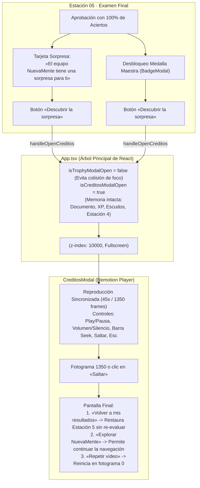

# 🎬 Entrega: Experiencia Cinematográfica Completa de Créditos de NuevaMente (45 segundos)

Este documento certifica y documenta la culminación de la experiencia audiovisual y cinematográfica de créditos de **NuevaMente**, integrando las **seis escenas narrativas**, la banda sonora sincronizada y la orquestación en el reproductor modal superpuesto (*modal fullscreen*), sin recargas de página y con preservación total del estado en React.

---

## 1. Ficha Técnica y Métricas del Proyecto

| Parámetro | Valor Oficial | Archivo de Origen |
| :--- | :--- | :--- |
| **Duración Total** | **45.00 segundos** (1,350 fotogramas) | `frontend/src/creditos/config.ts` |
| **Velocidad de Cuadro** | **30 FPS** | `frontend/src/creditos/config.ts` |
| **Resolución del Lienzo** | **1920 × 1080 (1080p Full HD)** | Relación de aspecto 16:9 |
| **Motor de Renderizado** | **Remotion 4.0.530** (Cliente / Navegador) | `frontend/package.json` |
| **Reproductor Integrado** | `@remotion/player` (Modal Fullscreen) | `frontend/src/creditos/CreditosModal.tsx` |
| **Banda Sonora Oficial** | *Midnight High Score* (MPEG-1 Layer 3, 44.1 kHz, 192 kbps) | `frontend/public/Midnight_High_Score.mp3` |
| **Duración del Audio** | 177.29 segundos (Fade-out suave en fotogramas 1305 a 1350) | `frontend/src/creditos/CreditosVideo.tsx` |

---

## 2. Arquitectura de Integración y Preservación de Estado



### Principios de Integración Garantizados:
1. **Sin recarga de navegador:** Al no invocar `window.location.href` ni navegaciones destructivas, la aplicación permanece 100% viva en memoria.
2. **Preservación del usuario invitado:** El usuario conserva el documento en análisis (`currentPackage`), la estación activa (`activeStationIndex`), los escudos cognitivos (`cognitiveShields = 3`), los XP acumulados y las medallas obtenidas.
3. **Desmontaje limpio:** Al cerrar el modal, el reproductor de Remotion se desmonta del DOM, eliminando la etiqueta `<Audio>` y evitando fugas de sonido en segundo plano.

---

## 3. Estructura Narrativa de las Seis Escenas

```
0s        3s             8s                   18s                  28s                  39s             45s
|--- E01 ---|---- E02 ----|------- E03 --------|------- E04 --------|------- E05 --------|----- E06 -----|
  Apertura    Morphing       Red de Agentes       Arquitectura         Créditos             Clímax &
  8-Bit CRT   Holográfico    Pedagógicos          Nube OCI Stack       Equipo 10            Agradecimiento
  (90f)       (150f)         (300f)               (300f)               (330f)               (180f)
```

| Escena | Título Narrativo | Rango Temporal | Fotogramas | Componentes y Objetivos Visuales |
| :---: | :--- | :---: | :---: | :--- |
| **01** | **Apertura 8-Bit & Boot Terminal** | 00:00 – 00:03 | `0 – 90` (90f) | Encendido CRT progresivo (`crtScaleX`, `crtScaleY`), telemetría BIOS v2.0 (G10 LATAM), contador hexadecimal de memoria, barra de carga ASCII (0% a 100% entre f20 y f72) y barrido del logotipo 32×32 pixel art con glitch final. |
| **02** | **Morphing Orgánico a Núcleo 3D** | 00:03 – 00:08 | `90 – 240` (150f) | Desprendimiento del 15.4% de píxeles periféricos (36 chispas), relieve tridimensional en cinta de Möbius preservando la silueta del infinito, revelado del vector oficial SVG, 3 anillos HUD concéntricos con rotación multi-eje y pulso rítmico a 140 BPM. |
| **03** | **Red de Agentes Pedagógicos** | 00:08 – 00:18 | `240 – 540` (300f) | Constelación orbital con el núcleo de NuevaMente al centro y 5 nodos de agentes pedagógicos (Ingesta RAG, Resumen Ninja, Flashcards, Tutorial y Evaluación). Curvas Bézier con flujo continuo de paquetes de datos y pulso de sincronización global al fotograma 210. |
| **04** | **Arquitectura OCI & Stack Técnico** | 00:18 – 00:28 | `540 – 840` (300f) | Blueprint HUD de infraestructura en 4 capas reales verificadas: Capa Cliente (React 19 + Remotion Player), Orquestación (FastAPI Async + Verificador de Citas), Inferencia RAG (Gemini + Cohere + ChromaDB) y Nube OCI Always Free (VM Compute 1 GB RAM + Object Storage). |
| **05** | **Créditos Oficiales del Equipo 10** | 00:28 – 00:39 | `840 – 1170` (330f) | Tipografía cinematográfica en tarjetas glassmorphism divididas en dos fases: Liderazgo y Arquitectura Principal (Project Management, Liderazgo Backend y Frontend) e Ingeniería Backend, QA, Frontend y Colaboración Técnica. |
| **06** | **Clímax & Agradecimiento Institucional** | 00:39 – 00:45 | `1170 – 1350` (180f) | Regreso heroico del isotipo con resplandor cromático cyan/violeta/magenta, convergencia de los anillos HUD concéntricos y cuadro institucional de agradecimiento a **Oracle Next Education (ONE G10)**, **Alura Latam** y **No-Country Simulation**. |

---

## 4. Banda Sonora y Sincronización

- **Archivo fuente:** `frontend/public/Midnight_High_Score.mp3` (4,261,107 bytes, ~4.06 MB).
- **Inicio de reproducción:** La directiva `autoPlay={true}` arranca en fase tras la interacción de usuario (clic en «Descubrir la sorpresa»), cumpliendo las políticas de autoplay de navegadores modernos.
- **Sincronización:** Remotion vincula el tiempo del elemento `<Audio>` directamente al fotograma (`frame / fps`). Pausar, reanudar o arrastrar el cursor de progreso mantiene la música en fase exacta.
- **Cierre suave (*fade-out*):** En `frontend/src/creditos/CreditosVideo.tsx`, una curva `interpolate` reduce el volumen de 1 a 0 durante los últimos 45 fotogramas (segundos 43.5 a 45.0), eliminando cortes abruptos antes de mostrar la pantalla final.

---

## 5. Créditos Oficiales del Equipo 10

Estructura organizada por roles y responsabilidades técnicas para el Hackathon ONE G10:

### Liderazgo y Arquitectura de Producto
- **Facilitación & Project Management:** Coordinación general del proyecto, requerimientos funcionales y metodologías ágiles (ONE G10).
- **Líder Técnico Backend & Arquitectura:** Diseño del pipeline multiagente, verificación de citas contra fuentes y cliente OCI Object Storage.
- **Líder Técnica Frontend & UI/UX:** Arquitectura de componentes interactivos, diseño del sistema visual y desarrollo de las 5 estaciones pedagógicas.

### Ingeniería, Control de Calidad y Colaboración
- **Backend & Cloud Integration:** Contratos Pydantic v2, ChromaDB vectorial HNSW, API REST en FastAPI y orquestación en cascada.
- **Frontend, QA & Diseño de Producto:** Control de calidad de interfaz, accesibilidad ARIA, diseño responsivo y pruebas de experiencia de usuario.
- **Colaboración Técnica & Documentación:** Validación de contratos compartidos, documentación técnica y actas de arquitectura.

---

## 6. Pruebas Automatizadas y Validación Técnica

### A. Resultados de la Suite de Pruebas (`npm test`)
Ejecutadas con el motor nativo de Node.js (`node --test "tests/**/*.test.ts"`):
- **Total de pruebas ejecutadas:** 72 pruebas.
- **Resultado:** **72 PASSED, 0 FAILED** (100% de éxito en 4.16 segundos).
- **Pruebas específicas de créditos e integración:**
  - ✔ *Recursos audiovisuales oficiales: archivo de música Midnight High Score e Isotipo presentes.*
  - ✔ *Configuración de Remotion para reproducción sincronizada (1350 frames, 45s, 30fps).*
  - ✔ *Integración no destructiva: preserve el árbol de React en memoria.*
  - ✔ *Estación 5 (Quiz): incorpora botón Descubrir la sorpresa en pantalla de éxito.*
  - ✔ *BadgeModal: ofrece acceso a la sorpresa al desbloquear la Medalla Maestra.*
  - ✔ *Banda sonora: implementación de fade-out suave al cierre del video.*
  - ✔ *CreditosModal: controles accesibles, atajos de teclado y adaptación responsive.*
  - ✔ *Estructura de 6 escenas cinematográficas montadas en secuencia (45.0s).*
  - ✔ *Créditos oficiales del Equipo 10: estructura de roles y responsabilidades técnicas confirmada.*
  - ✔ *Configuración de Remotion: 1920x1080 @ 30fps y 1350 frames completos (45.0s).*
  - ✔ *Determinismo de la barra de carga 8-bit y fase Glitch & Partículas.*
  - ✔ *Escena 02 Timing & Determinismo: Desprendimiento, Convergencia y Núcleo Holográfico.*

### B. Compilación de Producción (`npm run build`)
- Ejecutado: `tsc -b && vite build`.
- **Resultado:** **Exitoso (exit code 0)** en 9.85 segundos, generando los bundles en `dist/` sin advertencias de tipos ni dependencias rotas.

---

## 7. Puesta en Marcha y Validación en Navegador

Los servicios locales se encuentran activos en sus puertos designados:

```bash
# Backend FastAPI (Puerto 8000)
.\.venv\Scripts\python.exe -m uvicorn app.main:app --app-dir backend --host 127.0.0.1 --port 8000

# Frontend React 19 + Vite (Puerto 5173)
cd frontend && npm.cmd run dev
```

### URLs de Acceso:
- **Aplicación completa:** [http://localhost:5173/](http://localhost:5173/) *(Completar el quiz al 100% para activar el modal sorpresa).*
- **Visor independiente de créditos:** [http://localhost:5173/creditos.html](http://localhost:5173/creditos.html) *(Incluye botones para saltar a cada escena: E1 a E6).*
- **Documentación Swagger API:** [http://127.0.0.1:8000/docs](http://127.0.0.1:8000/docs).
