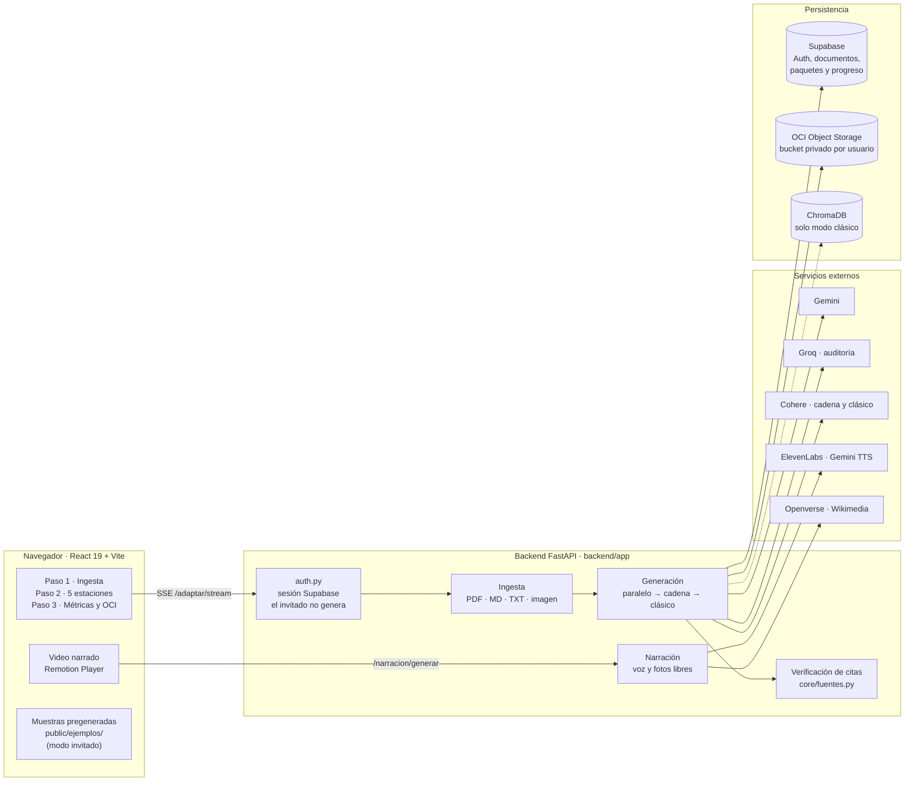
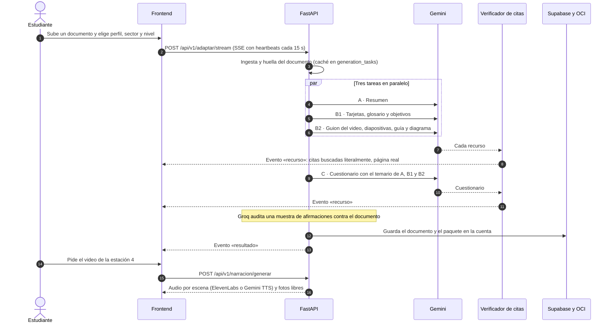
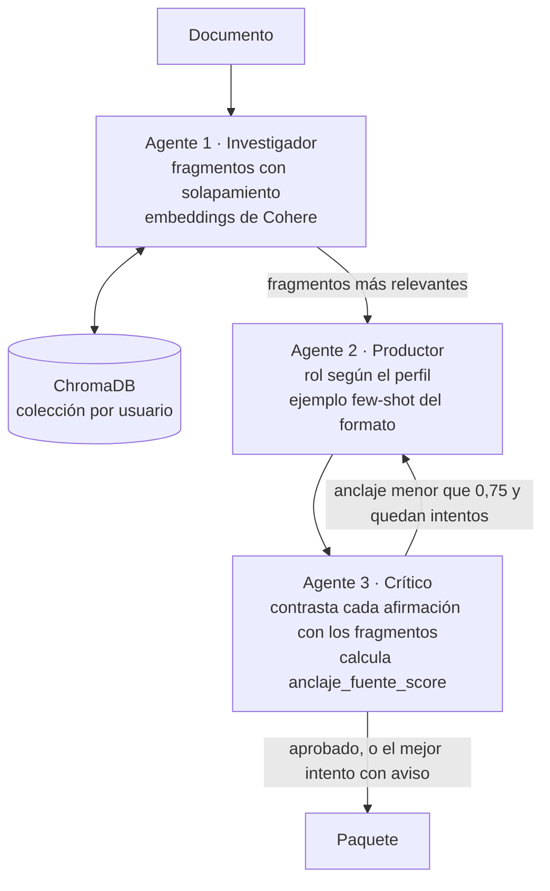

# 🧠 NuevaMente — Sistema Inteligente de Adaptación y Generación de Contenido Educativo

> **Desarrollado por el Equipo 10 (G10 - NuevaMente) para No-Country**  
> **Hackathon ONE G10 · Oracle Next Education & Alura · Proyecto 1**  
> Convierte un documento técnico en un recorrido de 5 estaciones. **Backend FastAPI + Frontend React 19 + Vite**, generación con **Gemini en paralelo** y citas verificadas contra el documento, video narrado en el navegador, y persistencia en **Supabase** y **OCI Object Storage**. La cadena colaborativa (Gemini, Groq y Cohere) y el RAG con **LangGraph**, **Cohere** y **ChromaDB** quedan como respaldo.

<p align="center">
  
</p>

---

## Estado actual — 16 de octubre de 2026

Así funciona hoy la aplicación; las secciones 1 a 7 detallan la arquitectura, los flujos y la puesta en marcha.

**Recorrido del estudiante**

1. **Configuración e ingesta.** En **modo invitado** (sin sesión) se elige un documento de la biblioteca (Don Quijote I y II, Apache Kafka, ENISA Threat Landscape y la guía de swap de OCI) y se abre su **muestra pregenerada** (`frontend/public/ejemplos/`), sin llamar a ningún modelo: el backend rechaza con 403 cualquier generación del invitado. **Apache Kafka trae 5 escenarios del mismo documento** para comparar: 4 perfiles (Principiante, Desarrollador Junior, Líder Técnico y Gestor/Ejecutivo) en Finanzas, el mismo perfil en Salud y uno generado con el modo clásico (RAG vectorial). Los otros documentos muestran cómo influye el sector (Industria, Salud, Leyes, Marketing). El botón «Prueba rápida 😊» abre la guía de OCI en un clic. Con sesión se puede subir un archivo propio (PDF, MD, TXT o imagen), elegir perfil, sector y nivel, y el resultado se guarda en la cuenta.
2. **Visualizar Resultados: cinco estaciones.**

| Estación | Qué enseña |
|---|---|
| 1 · Resumen | Analogía central, conceptos con su cita verificada, resumen por secciones y diagrama Mermaid |
| 2 · Tarjetas didácticas | Pregunta y respuesta con pista |
| 3 · Guía paso a paso | «¿Cuál es la meta de leer "‹título›"?»: objetivos de aprendizaje y pasos con qué hacer y cómo comprobarlo; el comando en terminal solo si el documento es técnico |
| 4 · Contenido AudioVisual | Microclase narrada de hasta 60 s, dibujada en el navegador con Remotion Player (sin MP4 en el servidor) |
| 5 · Cuestionario | Examen final sobre lo que enseñaron las estaciones 1 a 4 |

3. **Métricas & OCI Cloud.** Auditoría de fidelidad y dónde quedó guardado el paquete.

**Cómo se genera un paquete** (`backend/app/agentes/generacion_paralela.py`)

- Tres llamadas a Gemini en paralelo: **A** (resumen), **B1** (tarjetas, glosario y objetivos) y **B2** (guion del video, diapositivas, guía paso a paso y diagrama). B2 pide de 3 a 7 pasos según el largo y las secciones del documento.
- Después, **C** genera el cuestionario con el temario que enseñaron A, B1 y B2, para que solo pregunte por lo que el estudiante ya vio.
- Cada recurso se comprueba antes de publicarse: cada cita se busca literalmente en el documento y la página sale de ahí, nunca del modelo. Se envía por SSE en cuanto está listo y al final lo audita Groq.
- La voz del video se genera bajo demanda: ElevenLabs y, de respaldo, Gemini TTS.

**Los tres modos de generación (`modo_rag`) y el relevo entre ellos** (`backend/app/main.py`, `_generar_segun_modo`)

| Modo | Qué hace | Dónde |
|---|---|---|
| `paralelo` | **El que usa la aplicación:** el frontend lo envía por defecto (`VITE_MODO_RAG`). Gemini con las tareas A, B1, B2 y C descritas arriba, publicación incremental por SSE, citas verificadas en Python, caché por huella en `generation_tasks` y auditoría con Groq. | `agentes/generacion_paralela.py` |
| `vectorless` (cadena colaborativa) | RAG sin vectores: el documento entra completo en el contexto. Gemini genera las estaciones, Groq audita las afirmaciones contra el documento (`anclaje_fuente_score`) y Cohere adapta el tono al perfil y al sector. Es el valor por defecto del formulario de la API si no se envía `modo_rag`. | `agentes/cadena_colaborativa.py` |
| `clasico` | RAG vectorial con LangGraph: Cohere crea los embeddings, ChromaDB recupera fragmentos, un agente redacta y otro audita, con reintentos si el anclaje no llega al umbral. | `core/orchestrator.py`, `agentes/agente{1,2,3}_*.py` |

Si un modo no da resultado, se pasa al siguiente y el paquete lo advierte: **paralelo → cadena colaborativa → clásico**. El modo paralelo solo conmuta si ninguna tarea produjo recursos; si falla un recurso suelto, ese recurso queda marcado como fallido y no se inventa. Dentro de la cadena colaborativa, una cuota agotada (429) pasa de un proveedor a otro entre Gemini, Groq y Cohere antes de recurrir al clásico.

**Base de datos (Supabase).** Las migraciones de `supabase/migrations/` se aplican en orden; la última, `202610160001_tarea_cuestionario.sql`, admite la tarea `C` en `generation_tasks`.

**Documentación:** este README es la única documentación publicada. La documentación por área, las bitácoras y el historial de cambios se llevan en local.

---

## 🏛️ 1. Arquitectura

El navegador dibuja el recorrido y el video; el backend ingiere, genera, verifica y guarda. Todos los servicios externos se usan en su capa gratuita.



| Modo (`modo_rag`) | Cuándo se usa | Qué hace |
|---|---|---|
| `paralelo` | Siempre, desde la aplicación | Gemini genera los recursos en paralelo y después el cuestionario; cada cita se verifica en el documento y cada recurso llega por SSE apenas está listo (sección 2). |
| `vectorless` · cadena colaborativa | Si el paralelo no produce ningún recurso | El documento entra completo en el contexto: Gemini genera, Groq audita las afirmaciones y Cohere adapta el tono. |
| `clasico` · RAG vectorial | Si la cadena también falla, o pedido explícito | Fragmentos, embeddings de Cohere, búsqueda en ChromaDB y tres agentes en LangGraph (sección 3). |

---

## 🔄 2. Flujo del modo paralelo (el que usa la aplicación)



Si un recurso falla, se marca como fallido y no se rellena. La página de cada cita sale del documento, nunca del modelo.

---

## 🧠 3. Flujo RAG y agentes (modo clásico)

Es el respaldo final y el que demuestra la ruta RAG con base vectorial. En la biblioteca, uno de los 5 escenarios de Apache Kafka está generado con este modo y lo indica.



El umbral (`MIN_ANCLAJE_FUENTE_SCORE`, 0,75) y los reintentos (`MAX_REDACCION_RETRIES`, 2) se configuran en `.env`. El grafo está en `backend/app/core/orchestrator.py` y los agentes en `backend/app/agentes/agente{1,2,3}_*.py`.

---

## 🔌 4. API

| Método y ruta | Para qué |
|---|---|
| `GET /health` | Estado del servicio |
| `GET /api/v1/config/opciones` | Perfiles, sectores, niveles y formatos |
| `POST /api/v1/documentos/extraer` | Texto de un archivo; imágenes y PDF escaneados se transcriben con Gemini |
| `POST /api/v1/adaptar` · `/adaptar/stream` | Genera el paquete (JSON completo, o por SSE recurso a recurso) |
| `POST /api/v1/narracion/generar` · `/narracion/ampliar` | Voz y fotos del video; ampliar una escena |
| `GET /api/v1/paquetes` · `/paquetes/{id}` | Historial privado de la cuenta |
| `GET /api/v1/documentos/ejemplos…` | Documentos de la biblioteca |

Todo lo que gasta cuota exige sesión. El invitado recibe 403: solo abre las muestras pregeneradas. La documentación interactiva está en `http://127.0.0.1:8000/docs`.

---

## 📂 5. Estructura del repositorio

```text
.
├── backend/
│   ├── app/
│   │   ├── main.py          # endpoints, relevo entre modos y SSE
│   │   ├── auth.py          # sesión de Supabase; el invitado no genera
│   │   ├── agentes/         # generacion_paralela.py (por defecto), cadena_colaborativa.py, agente1-3 (clásico)
│   │   ├── core/            # schemas.py (contratos), fuentes.py (citas), ingestion.py, config.py, orchestrator.py, prompts.py
│   │   ├── servicios/       # Gemini, voz, imágenes, narración, transcripción, registro de tareas
│   │   ├── storage/         # OCI, disco local y almacén de narraciones, separados por usuario
│   │   └── integration/     # adaptadores privados por usuario
│   └── tests/               # pytest; los modelos se simulan
├── frontend/
│   ├── src/                 # App.tsx, components/ (pasos y estaciones), services/, utils/, types/
│   ├── public/ejemplos/     # muestras pregeneradas: paquete, voz y fotos con su licencia
│   └── tests/               # node --test
├── contracts/fixtures/      # caso de referencia del modelo de tiempo, compartido por backend y frontend
├── supabase/                # migraciones y prueba de propiedad (RLS)
├── data/documents/          # documentos de la biblioteca
├── docs/                    # diagrama del flujo (SVG)
├── scripts/                 # diagnóstico de OCI, prueba de estrés y restablecimiento local
├── tests/                   # pruebas del orquestador clásico
└── setup.bat · iniciar_local.bat · reestablecer_local.bat
```

---

## 🚀 6. Puesta en marcha local

**Requisitos:** Python 3.12 y Node.js 22 o superior.

**Claves** (en `.env`, a partir de `.env.example`; nunca en variables `VITE_*`):

| Variable | ¿Hace falta? | Para qué |
|---|---|---|
| `GEMINI_API_KEY` | Sí | Generación, transcripción de imágenes y voz de respaldo |
| `SUPABASE_URL` · `SUPABASE_PUBLISHABLE_KEY` | Sí (ya vienen en `.env.example`, son públicas) | Inicio de sesión y persistencia |
| `ELEVENLABS_API_KEY` | No | Voz del video; sin ella, Gemini TTS y, si tampoco, la voz del navegador |
| `GROQ_API_KEY` | No | Auditoría de fidelidad |
| `COHERE_API_KEY` | No | Modos cadena colaborativa y clásico |
| `OCI_*` | No | Bucket de OCI; sin ellas, el paquete se guarda en disco (`data/outputs/`) |

**En Windows:** `setup.bat` crea `.venv` e instala todo; `iniciar_local.bat` levanta el backend (puerto 8000) y el frontend (puerto 5173).

**A mano:**

```bash
python -m venv .venv
.venv/Scripts/python -m pip install -r requirements.txt     # Linux/macOS: .venv/bin/python
cp .env.example .env                                        # y completar las claves
.venv/Scripts/python -m uvicorn app.main:app --app-dir backend --port 8000

# en otra terminal
cd frontend
npm ci
cp .env.example .env.local
npm run dev
```

Abrir **http://localhost:5173**: con `localhost` y no `127.0.0.1`, porque es el origen autorizado para el inicio de sesión.

Las muestras de `frontend/public/ejemplos/` se regeneran con un script local que llama a un backend arrancado con `PERMITIR_GENERACION_INVITADO=true`. Ese permiso no debe ir nunca en un servidor público.

---

## ⚙️ 7. Decisiones técnicas

1. **Procedencia honesta.** Nada se presenta como verificado si no lo está. Las citas se buscan literalmente en el documento y la página sale de ahí; un recurso que falla se muestra como fallido; si el texto lo transcribió la IA, se dice.
2. **Solo cuota gratuita.** El modo invitado no gasta cuota: el backend rechaza sus generaciones con 403 y las muestras son archivos estáticos. Las fotos son de bancos libres con licencias que permiten adaptarlas, y se muestran con autor y licencia.
3. **VM de OCI con 1 vCPU y 1 GB.** No hay MP4 ni FFmpeg en el servidor: el video son diapositivas narradas que dibuja el navegador. Las generaciones simultáneas se limitan con un semáforo (5 a la vez).
4. **Cloudflare corta a los 100 s.** La generación va por SSE con heartbeats cada 15 s.
5. **Claves solo en el backend.** En el navegador solo hay valores públicos (`VITE_API_URL`, `VITE_SUPABASE_*`).
6. **Aislamiento por usuario.** El backend verifica el token con Supabase, consulta Postgres con el JWT del usuario (RLS) y guarda en OCI bajo `users/<UUID>/` en un bucket privado. ChromaDB también tiene una colección por usuario.
7. **CORS.** Se admiten `localhost` y `127.0.0.1` en cualquier puerto. En producción hay que agregar el dominio público a `allow_origins` en `backend/app/main.py`.
8. **Repositorio.** En GitHub se publican el código, las pruebas, las migraciones, las muestras y este README. La documentación por área, las bitácoras y el historial de cambios se conservan en local.

---

## 🧪 8. Suite de Pruebas Automatizadas

Las pruebas son deterministas: Gemini, Groq, ElevenLabs y los bancos de imágenes se simulan, así que no gastan cuota. Al 16/10/2026 son **340 en el backend y 48 en el frontend**; la cifra al día es la que dan los comandos:

```bash
cd backend && ../.venv/Scripts/python -m pytest -q
cd frontend && npm test && npx tsc --noEmit -p .
```

**Estado de la suite al 16/10/2026:** 🟢 **340 pasadas en backend y 48 en frontend, 0 fallidas.**

---

## 👥 9. Créditos y Autores del Proyecto

* **Alejandro (`origin/backend` / `Propuesta-Microservicios`)**: Arquitectura de microservicios, servidor REST en FastAPI, módulo de ingesta multi-formato con pypdf, cliente oficial de OCI Object Storage SDK y guías de despliegue en Oracle Cloud.
* **Pedro (`origin/feature/agents-langgraph`)**: Motor multi-agente en LangGraph, prompting pedagógico adaptativo, RAG vectorial con Cohere y ChromaDB, validación de contratos Pydantic v2 y suite determinista de 70 pruebas automatizadas (100% éxito).
* **Frontend Lead (`origin/frontEnd`)**: Microservicio web cliente en React 19 + TypeScript + Vite, cliente HTTP desacoplado con soporte multipart, visualizadores interactivos de los 5 formatos pedagógicos (Flashcards 3D, Quiz, Tutorial, TL;DR, Guión) y dashboard de métricas RAG.
* **Project Manager (`origin/project-manager`)**: Gobernanza, definición funcional de requerimientos, cronograma de trabajo, actas de acuerdos y alineación estratégica con los objetivos del Hackathon ONE G10.
* **Equipo NuevaMente (`origin/integracion` ➔ `origin/main`)**: Sinergia técnica de integración continua, armonización de contratos, scripts unificados de ejecución local (`iniciar_local.bat`), validación End-to-End con score de anclaje RAG de 1.00 y empaquetado para release final.

---

## Autenticación con Supabase

1. Node.js 22+; en `frontend`, ejecutar `npm ci`, copiar `.env.example` a `.env.local` y ejecutar `npm run dev -- --host 127.0.0.1 --port 5173 --strictPort`. Abrir **http://localhost:5173** (no cambiar a 127.0.0.1 para el login: el origen/callback debe estar autorizado).
2. Python y dependencias de `requirements.txt`; configurar el `.env` raíz con `GEMINI_API_KEY` y las dos variables públicas `SUPABASE_URL` / `SUPABASE_PUBLISHABLE_KEY` de `.env.example` (ver la sección 6).
3. Desde la raíz, ejecutar `python -m uvicorn app.main:app --app-dir backend --host 127.0.0.1 --port 8000`. El backend usa HTTPX para verificar la sesión y escribir en Supabase, no necesita un secreto JWT ni clave administrativa.
4. El esquema `supabase/migrations/202610080001_auth_and_persistence.sql` **ya está aplicado en el proyecto NuevaMente**. No volver a ejecutarlo sobre las tablas existentes. Para un proyecto nuevo, aplicar primero el SQL y configurar Google. Para usar CLI en el proyecto actual, reconciliar el historial de migraciones antes de `db push`.

### Configuración de Google Auth

El navegador solo necesita `VITE_SUPABASE_URL` y `VITE_SUPABASE_PUBLISHABLE_KEY`; el backend usa `SUPABASE_URL` y `SUPABASE_PUBLISHABLE_KEY`. En Google Cloud, `http://localhost:5173` va en **Orígenes autorizados de JavaScript**. La URI autorizada de redirección de Google es la callback de Supabase: `https://pvgafxwsmatjebklmqlc.supabase.co/auth/v1/callback`. En Supabase Dashboard → Authentication → URL Configuration, permitir `http://localhost:5173/auth/callback` como redirect URL. El Client ID y Client Secret de Google se guardan en Supabase Dashboard → Authentication → Providers → Google; nunca se agregan al frontend ni a variables `VITE_*`.

El login con Google no necesita SMTP. El registro con correo/contraseña sí depende de que Supabase pueda enviar el mensaje de confirmación cuando la confirmación de email está activada; para entregar a direcciones fuera del equipo hay que configurar un SMTP propio en Supabase Auth. El SMTP del backend (`SMTP_*`) es independiente y solo se usa para enviar dossiers PDF.
