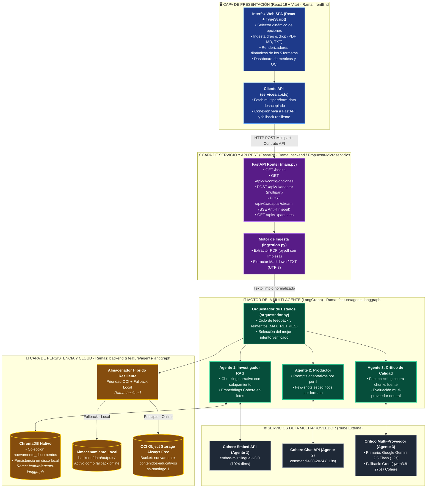
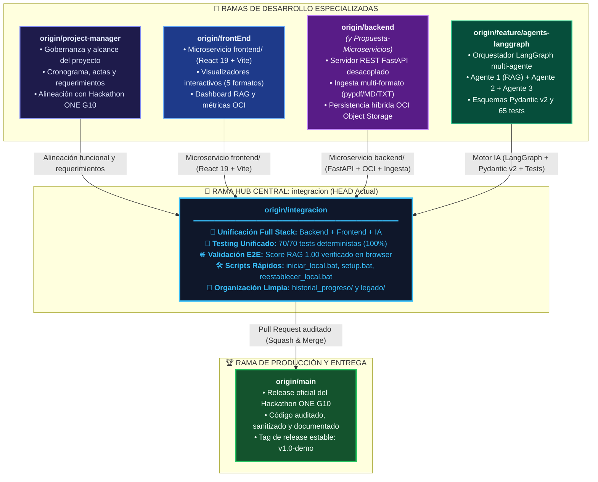
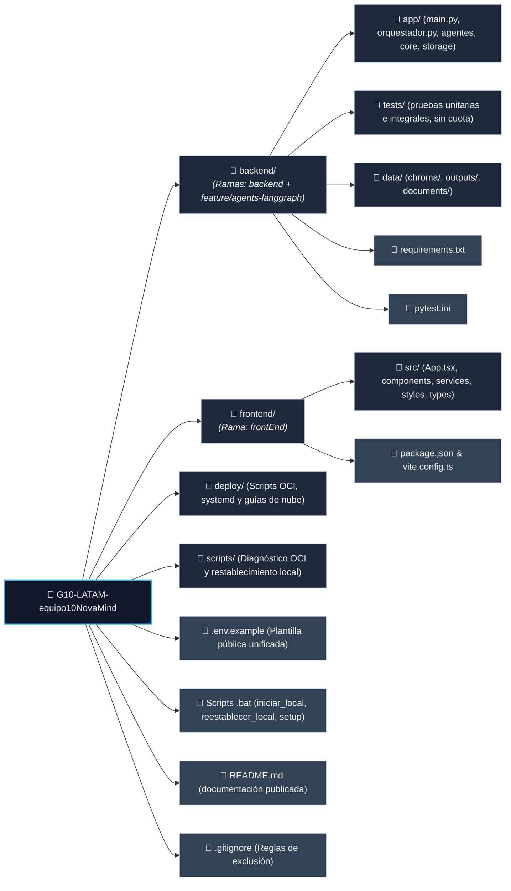
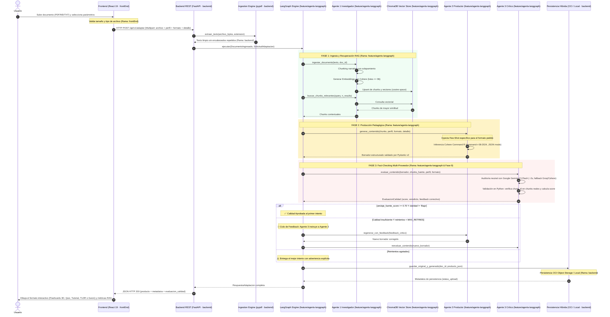
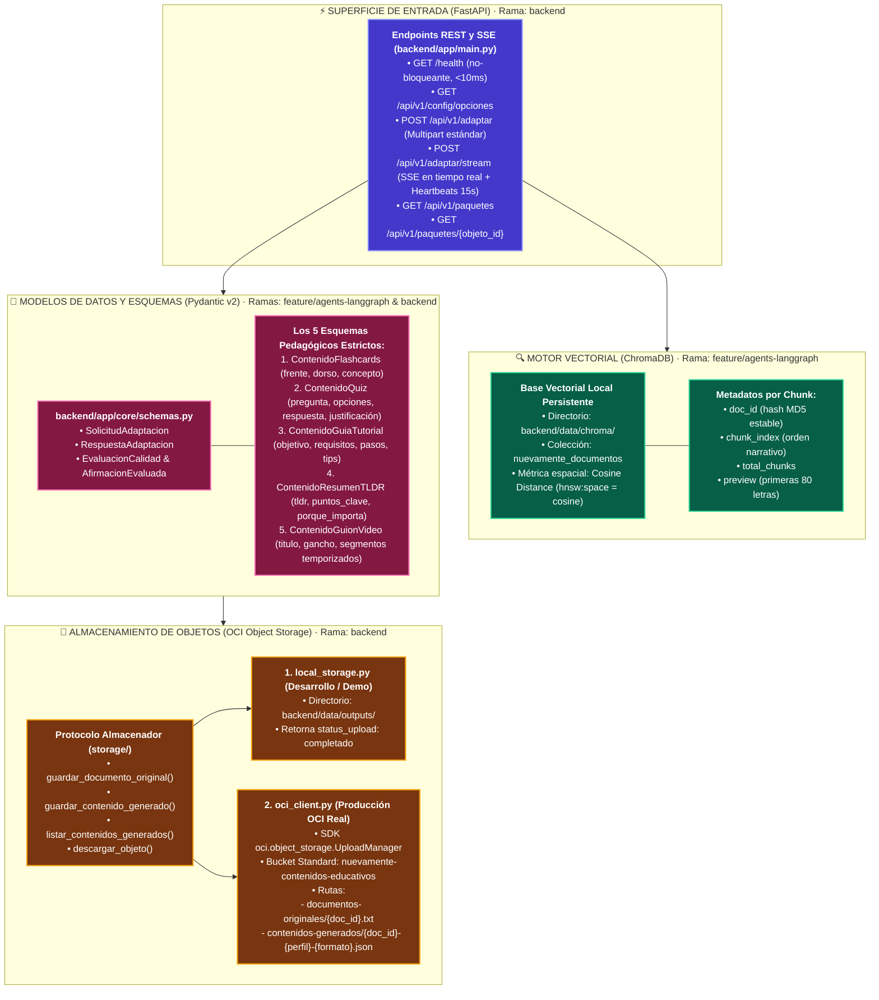

# 🧠 NuevaMente — Sistema Inteligente de Adaptación y Generación de Contenido Educativo

> **Desarrollado por el Equipo 10 (G10 - NuevaMente) para No-Country**  
> **Hackathon ONE G10 · Oracle Next Education & Alura · Proyecto 1**  
> Convierte un documento técnico en un recorrido de 5 estaciones. **Backend FastAPI + Frontend React 19 + Vite**, generación con **Gemini en paralelo** y citas verificadas contra el documento, video narrado en el navegador, y persistencia en **Supabase** y **OCI Object Storage**. La cadena colaborativa (Gemini, Groq y Cohere) y el RAG con **LangGraph**, **Cohere** y **ChromaDB** quedan como respaldo.

<p align="center">
  
</p>

---

## Estado actual — 16 de octubre de 2026

Las secciones posteriores conservan la historia de las fases del proyecto (LangGraph, Cohere, ChromaDB). Así funciona hoy la aplicación:

**Recorrido del estudiante**

1. **Configuración e ingesta.** En **modo invitado** (sin sesión) se elige un documento de la biblioteca (Don Quijote I y II, Apache Kafka, ENISA Threat Landscape y la guía de swap de OCI) y se abre su **muestra pregenerada** (`frontend/public/ejemplos/`), sin llamar a ningún modelo: el backend rechaza con 403 cualquier generación del invitado. **Apache Kafka trae 5 escenarios del mismo documento** para comparar: 4 perfiles (Principiante, Desarrollador Junior, Líder Técnico y Gestor/Ejecutivo) en Finanzas, el mismo perfil en Salud y uno generado con el modo clásico (RAG vectorial). Los otros documentos muestran cómo influye el sector (Industria, Salud, Leyes, Marketing). El botón «Prueba rápida 😊» abre la guía de OCI en un clic. Con sesión se puede subir un archivo propio (PDF, MD, TXT o imagen), elegir perfil, sector y nivel, y el resultado se guarda en la cuenta.
2. **Visualizar Resultados: cinco estaciones.**

| Estación | Qué enseña |
|---|---|
| 1 · Resumen | Analogía central, conceptos con su cita verificada, resumen por secciones y diagrama Mermaid |
| 2 · Tarjetas didácticas | Pregunta y respuesta con pista |
| 3 · Guía paso a paso | «¿Cuál es la meta de leer "‹título›"?»: objetivos de aprendizaje y pasos con qué hacer y cómo comprobarlo; el comando en terminal solo si el documento es técnico |
| 4 · Contenido AudioVisual | Microclase narrada de hasta 60 s, dibujada en el navegador con Remotion Player (sin MP4 en el servidor) |
| 5 · Cuestionario | Examen final sobre lo que enseñaron las estaciones 1 a 4 |

3. **Métricas & OCI Cloud.** Auditoría de fidelidad y dónde quedó guardado el paquete.

**Cómo se genera un paquete** (`backend/app/agentes/generacion_paralela.py`)

- Tres llamadas a Gemini en paralelo: **A** (resumen), **B1** (tarjetas, glosario y objetivos) y **B2** (guion del video, diapositivas, guía paso a paso y diagrama). B2 pide de 3 a 7 pasos según el largo y las secciones del documento.
- Después, **C** genera el cuestionario con el temario que enseñaron A, B1 y B2, para que solo pregunte por lo que el estudiante ya vio.
- Cada recurso se comprueba antes de publicarse: cada cita se busca literalmente en el documento y la página sale de ahí, nunca del modelo. Se envía por SSE en cuanto está listo y al final lo audita Groq.
- La voz del video se genera bajo demanda: ElevenLabs y, de respaldo, Gemini TTS.

**Los tres modos de generación (`modo_rag`) y el relevo entre ellos** (`backend/app/main.py`, `_generar_segun_modo`)

| Modo | Qué hace | Dónde |
|---|---|---|
| `paralelo` | **El que usa la aplicación:** el frontend lo envía por defecto (`VITE_MODO_RAG`). Gemini con las tareas A, B1, B2 y C descritas arriba, publicación incremental por SSE, citas verificadas en Python, caché por huella en `generation_tasks` y auditoría con Groq. | `agentes/generacion_paralela.py` |
| `vectorless` (cadena colaborativa) | RAG sin vectores: el documento entra completo en el contexto. Gemini genera las estaciones, Groq audita las afirmaciones contra el documento (`anclaje_fuente_score`) y Cohere adapta el tono al perfil y al sector. Es el valor por defecto del formulario de la API si no se envía `modo_rag`. | `agentes/cadena_colaborativa.py` |
| `clasico` | RAG vectorial con LangGraph: Cohere crea los embeddings, ChromaDB recupera fragmentos, un agente redacta y otro audita, con reintentos si el anclaje no llega al umbral. | `core/orchestrator.py`, `agentes/agente{1,2,3}_*.py` |

Si un modo no da resultado, se pasa al siguiente y el paquete lo advierte: **paralelo → cadena colaborativa → clásico**. El modo paralelo solo conmuta si ninguna tarea produjo recursos; si falla un recurso suelto, ese recurso queda marcado como fallido y no se inventa. Dentro de la cadena colaborativa, una cuota agotada (429) pasa de un proveedor a otro entre Gemini, Groq y Cohere antes de recurrir al clásico.

**Base de datos (Supabase).** Las migraciones de `supabase/migrations/` se aplican en orden; la última, `202610160001_tarea_cuestionario.sql`, admite la tarea `C` en `generation_tasks`.

**Documentación:** este README es la única documentación publicada. La documentación por área, las bitácoras y el historial de cambios se llevan en local.

---

## 📖 Visión General del Proyecto

**NuevaMente** es una plataforma diseñada para democratizar y personalizar el aprendizaje técnico. Transforma documentos complejos (manuales de ingeniería, guías de arquitectura, documentación de APIs) en **5 formatos pedagógicos adaptados** al perfil del estudiante, nivel de profundidad y sector laboral.

### La Fusión Multidisciplinaria del Equipo NuevaMente (Integración Multirama)
Este sistema consolida la integración técnica de las diferentes ramas y roles de trabajo del equipo:
1. **Gobernanza y Planificación (`origin/project-manager`)**: Definición del alcance pedagógico, matriz de requerimientos del Hackathon ONE G10, actas y criterios de aceptación.
2. **Microservicio Frontend (`origin/frontEnd`)**: Interfaz web reactiva (React 19 + TypeScript + Vite) con visualizadores pedagógicos dinámicos (Flashcards 3D, Quiz, Tutorial, TL;DR, Guión) y dashboard de auditoría RAG.
3. **Infraestructura y Despliegue (`origin/backend` / `Propuesta-Microservicios` - Alejandro)**: Arquitectura de microservicios reales desacoplados, servidor web REST en FastAPI, ingesta multi-formato (PDF con extracción limpia, Markdown, TXT), cliente SDK de OCI Object Storage Always Free y despliegue modular.
4. **Motor de IA y Agentes (`feature/agents-langgraph` - Pedro & Fase 9)**: Grafo cíclico multi-agente en LangGraph con feedback reflexivo, prompting adaptativo con few-shots específicos por formato, RAG vectorial con Cohere (`embed-multilingual-v3.0`), redacción optimizada con Cohere (`command-r-08-2024`), auditoría multi-proveedor desacoplada (Google Gemini 2.5 Flash / Groq / Cohere fallback), streaming SSE en tiempo real con heartbeats anti-timeout, validación estricta de esquemas con Pydantic v2 y suite determinista de 70 pruebas automatizadas (100% éxito).
5. **Hub de Integración Continua (`origin/integracion` - HEAD actual)**: Rama central donde convergen todos los módulos, se resuelven contratos HTTP/JSON, se unifican scripts de despliegue local (`iniciar_local.bat`), se organiza el repositorio (`historial_progreso/` y `legado/`) y se ejecutan las pruebas E2E antes del merge final a `main`.
6. **Rama de Producción y Release (`origin/main`)**: Rama troncal protegida para entrega final y demo estable (`v1.0-demo`).

---

## 🏛️ 1. Diagrama de Arquitectura General y Mapeo de Ramas

El sistema opera bajo un modelo cliente-servidor desacoplado mediante contratos HTTP REST, donde cada capa arquitectónica proviene de su respectiva rama especializada:



---

### 🌿 1.1 Topología de Integración de Ramas y Flujo Git (Gitflow del Proyecto)

El siguiente diagrama detalla cómo convergen las distintas ramas de trabajo del equipo en la rama hub `integracion` antes de su promoción a la rama troncal `main`:



#### Matriz de Contribución por Rama

| Rama Git | Área / Responsabilidad | Componentes Clave en el Repositorio | Estado en `integracion` |
| :--- | :--- | :--- | :---: |
| `origin/project-manager` | Gobernanza y Producto | Documentación de objetivos, actas de acuerdos y alineación Hackathon | 🟢 Consolidado en docs |
| `origin/frontEnd` | Microservicio Frontend | `frontend/` (React 19, TypeScript, Vite, Tailwind tokens, Lucide, visualizadores) | 🟢 Integrado y conectado |
| `origin/backend` | Microservicio Backend | `backend/app/main.py`, `ingestion.py`, `storage/oci_client.py`, `deploy/` | 🟢 Desacoplado vía REST + SSE |
| `origin/feature/agents-langgraph` | Inteligencia Artificial | `backend/app/orquestador.py`, `agentes/`, `core/schemas.py`, suite de 70 tests | 🟢 100% tests pasando (70/70) |
| `origin/integracion` *(HEAD)* | Hub de Integración Continua | Scripts `.bat`, `historial_progreso/`, `legado/`, CI local, validación E2E | 🚀 Activa y sincronizada |
| `origin/main` | Producción / Demo Final | Entrega evaluable final consolidada mediante Squash & Merge | 🏁 Destino de release |

---

## 📂 2. Diagrama de Estructura de Carpetas y Mapeo de Origen

La arquitectura del repositorio sigue una estricta separación de responsabilidades para aislar el frontend, la API de servicio, el motor multi-agente, la base de conocimiento y los artefactos históricos:



### Detalle de Carpetas y Responsabilidades Técnicas

```text
G10-LATAM-equipo10NovaMind/
├── .env.example                       # Plantilla de variables de entorno (Cohere, OCI, ChromaDB)
├── .gitignore                         # Exclusiones estrictas (.env, *.pem, __pycache__, .venv)
├── README.md                          # Documentación maestra y manual general del proyecto
├── requirements.txt                   # Dependencias principales unificadas de Python (FastAPI + LangGraph)
├── iniciar_local.bat                  # Script para arranque concurrente (FastAPI :8000 + React Vite :5173)
├── reestablecer_local.bat             # Script de restablecimiento y limpieza de entorno local
├── setup.bat                          # Asistente de verificación e instalación de dependencias
│
├── backend/                           # MICROSERVICIO BACKEND (FastAPI + LangGraph + Agentes)
│   ├── requirements.txt               # Dependencias limpias fijadas para Python 3.12.7
│   ├── pytest.ini                     # Configuración de pytest (testpaths = tests)
│   ├── tests/                         # Suite de pruebas deterministas, sin cuota
│   │   ├── test_api.py                # Validación de endpoints REST y SSE con TestClient (7 tests)
│   │   ├── test_critico_multiproveedor.py # Pruebas unitarias de Gemini, Groq, fallback y sanitización (4 tests)
│   │   ├── test_orquestador.py        # Pruebas unitarias de agentes, contratos y feedback (56 tests)
│   │   └── test_integracion_offline.py# Pipeline E2E con dependencias simuladas (3 tests)
│   ├── data/                          # Directorio de persistencia
│   │   ├── chroma/                    # Base vectorial persistente de ChromaDB
│   │   ├── documents/                 # Archivos fuente temporales y documentos cargados
│   │   └── outputs/                   # Salidas persistidas por la maqueta local de OCI
│   └── app/                           # Código fuente de la aplicación
│       ├── main.py                    # Servidor FastAPI (/health, /opciones, /adaptar, /adaptar/stream, /paquetes)
│       ├── orquestador.py             # Grafo de ejecución LangGraph y control de ciclo pedagógico
│       ├── agentes/                   # Clases independientes de los 3 agentes pedagógicos
│       │   ├── agente1_investigador.py# Ingesta, chunking y búsqueda semántica RAG
│       │   ├── agente2_productor.py   # Generación adaptativa con few-shots y formatos
│       │   └── agente3_critico.py     # Fact-checking y evaluación de anclaje a fuentes
│       ├── core/                      # Módulos centrales de lógica de negocio
│       │   ├── schemas.py             # Modelos Pydantic v2 de los 5 formatos y validadores
│       │   ├── prompts.py             # Prompts de sistema y ejemplos estructurados
│       │   ├── config.py              # Validación de variables de entorno y fallbacks
│       │   └── ingestion.py           # Extractor multi-formato (PDF, Markdown, TXT)
│       └── storage/                   # Capa de almacenamiento y persistencia híbrida
│           ├── local_storage.py       # Almacenamiento local estructurado (data/outputs/)
│           └── oci_client.py          # Cliente oficial con SDK de Oracle Cloud Object Storage
│
├── frontend/                          # MICROSERVICIO FRONTEND (React + Vite + TypeScript)
│   ├── package.json                   # Dependencias de UI (React 19, Lucide, Supabase, Mermaid)
│   ├── vite.config.ts                 # Configuración del empaquetador Vite
│   ├── index.html                     # Entrypoint HTML de la aplicación web
│   ├── tests/                         # Tests con node --test (tiempos, SSE incremental, voces, repaso)
│   └── src/                           # Código fuente TypeScript / TSX
│       ├── App.tsx                    # Raíz: sesión, progreso persistido y orquestación de los 3 pasos
│       ├── main.tsx                   # Punto de montaje del DOM en React 19
│       ├── components/
│       │   ├── Header/ · PlayerHUD/   # Cabecera con pasos, XP, escudos y medallas
│       │   ├── AuthModal/ · BadgeModal/   # Inicio de sesión y vitrina de medallas
│       │   ├── Step1Ingestion/        # Paso 1: subida (PDF, MD, TXT, imágenes), ejemplos y perfil
│       │   ├── Step2KnowledgeQuest/   # Paso 2: ruta cognitiva de 5 estaciones y avisos del paquete
│       │   ├── Step3OCICloud/         # Paso 3: persistencia en OCI y métricas de anclaje
│       │   ├── stations/              # Resumen, Flashcards, Tutorial, Video narrado (Director's Cut) y Quiz
│       │   ├── RecursoEstado/         # Estado por recurso: verificación, citas y página real
│       │   ├── RecursosApoyo/ · MermaidDiagram/   # Material de apoyo y diagramas
│       ├── services/                  # api.ts (HTTP + SSE), supabase.ts, persistence.ts
│       ├── utils/                     # Tiempos de locución, paquete incremental, voces, repaso del quiz
│       ├── data/mockScenarios.ts      # Biblioteca de documentos de ejemplo
│       ├── styles/                    # Design tokens OKLCH y estilos globales
│       └── types/types.ts             # Contratos TypeScript (espejo de backend/app/core/schemas.py)
│
├── deploy/                            # CONFIGURACIONES Y DESPLIEGUE EN NUBE (OCI)
│   ├── README_DESPLIEGUE_OCI.md       # Guía de arquitectura y provisión en Oracle Cloud
│   ├── scripts/                       # Scripts de configuración y despliegue para Linux/Ubuntu
│   └── systemd/                       # Unidades systemd para demonios de Backend y Frontend
│
└── scripts/                           # SCRIPTS AUXILIARES DE MANTENIMIENTO Y DIAGNÓSTICO
    ├── reestablecer_local.py          # Lógica Python de limpieza profunda de cache y entornos
    └── test_oci_conexion.py           # Script CLI de diagnóstico de conexión y subida a OCI
```

---

## 🔄 3. Diagrama de Flujo de Datos y Proceso End-to-End Multirama

El ciclo completo de transformación y auditoría pedagógica sigue una máquina de estados determinista gobernada por LangGraph, orquestando componentes provenientes de `frontEnd`, `backend` y `feature/agents-langgraph`:



---

## 🗄️ 4. Repositorios de Base de Datos y Capa Backend

La capa Backend se compone de tres motores de almacenamiento y persistencia claramente delimitados según su rama de origen:



---

## 🎯 5. Los 5 Formatos Pedagógicos Soportados

El sistema adapta cualquier documento técnico a **5 formatos pedagógicos especializados**, validados por esquemas Pydantic estrictos y renderizados interactivamente en la interfaz web de React:

| Formato Pedagógico | Modelo Pydantic | Características Principales | Renderizado en Frontend (React 19 + Vite) |
| :--- | :--- | :--- | :--- |
| **🗂️ Flashcards de Estudio** | `ContenidoFlashcards` | Pares de pregunta/respuesta atómicas, concepto clave y nivel de dificultad. | Tarjetas interactivas con efecto 3D flip card, contador de tarjetas y botones de revelación. |
| **📝 Quiz Interactivo** | `ContenidoQuiz` | Preguntas de opción múltiple con 4 alternativas y justificación técnica razonada. | Cuestionario interactivo con feedback instantáneo de acierto/error y justificación explicativa. |
| **🛠️ Guía Paso a Paso (Tutorial)** | `ContenidoGuiaTutorial` | Procedimiento secuencial ordenado con prerrequisitos, pasos de acción y advertencias. | Stepper interactivo con bloques de comandos de terminal y tarjetas de advertencia/tips. |
| **📋 Resumen Ejecutivo (TL;DR)** | `ContenidoResumenTLDR` | Síntesis concisa de alto impacto con análisis de *¿por qué le importa al destinatario?*. | Tarjetas de síntesis, métricas clave expandibles y sección de relevancia práctica. |
| **🎬 Guion de Clase / Video** | `ContenidoGuionVideo` | Guion estructurado por minutos con gancho inicial, contenido central y apoyos visuales. | Timeline secuencial con minutaje por bloque, notas de producción y apoyos visuales. |

---

## 🚀 6. Guía de Puesta en Marcha Local

### Requisitos Previos
- **Python 3.12.7** (versión oficial estandarizada del proyecto).
- **Node.js 18+ y npm** (para la interfaz web React 19).
- **API Keys de LLMs**:
  - **Cohere** (Requerida): Clave para embeddings y redacción del Agente 2 ([cohere.com](https://cohere.com)).
  - **Google Gemini** (Requerida / Primaria): Clave gratuita para el Agente 3 Crítico ([aistudio.google.com](https://aistudio.google.com)).
  - **Groq** (Opcional / Fallback): Clave gratuita para evaluación ultrarrápida de contingencia ([groq.com](https://groq.com)).
- *(Opcional)* Credenciales de Oracle Cloud si se desea persistencia en OCI Object Storage.

### Configurar Variables de Entorno
Copia la plantilla `.env.example` en la raíz como `.env`:
```bash
cp .env.example .env
```
Edita `.env` con las claves configuradas:
```env
COHERE_API_KEY=tu_api_key_de_cohere
COHERE_MODEL=command-r-08-2024
EMBEDDING_MODEL=embed-multilingual-v3.0

# Multi-Proveedor Agente 3 (Crítico de Calidad)
PROVEEDOR_CRITICO=gemini
MODELO_CRITICO=gemini-2.5-flash
GEMINI_API_KEY=tu_api_key_de_gemini
GROQ_API_KEY=tu_api_key_de_groq
```

---

### Opción A: Inicio Rápido Automático (Recomendado en Windows)

Ejecuta el script unificado que inicializa ambos microservicios en ventanas independientes:
```powershell
.\iniciar_local.bat
```
* **Backend FastAPI:** Inicia en segundo plano en [http://127.0.0.1:8000](http://127.0.0.1:8000).
* **Frontend React (Vite):** Inicia en [http://localhost:5173](http://localhost:5173).
* Abre automáticamente la aplicación en tu navegador web predeterminado.

---

### Opción B: Arranque Manual por Terminales

#### Terminal 1 — Backend FastAPI:
```bash
# 1. Crear y activar entorno virtual
python -m venv .venv
# Windows:
.\.venv\Scripts\activate
# Linux/macOS:
source .venv/bin/activate

# 2. Instalar dependencias
pip install -r requirements.txt

# 3. Iniciar servidor FastAPI
cd backend
uvicorn app.main:app --host 127.0.0.1 --port 8000 --reload
```
* **API Swagger interactivo:** [http://127.0.0.1:8000/docs](http://127.0.0.1:8000/docs)
* **Healthcheck:** [http://127.0.0.1:8000/health](http://127.0.0.1:8000/health)

#### Terminal 2 — Frontend React (Vite):
```bash
cd frontend
npm install
npm run dev
```
* **Interfaz Web SPA:** [http://localhost:5173](http://localhost:5173)

---

## 🌟 7. Estado Actual de la Integración Full Stack

El proyecto ha completado de manera exitosa y verificada las fases de integración técnica y optimización de latencia, consolidando un sistema 100% operativo, resiliente y desacoplado:

| Fase | Hito Técnico | Estado | Verificación |
| :--- | :--- | :---: | :--- |
| **Fase 1** | **Armonización de Entorno y Contratos** | 🟢 Completada | Dependencias fijadas para Python 3.12.7, esquemas Pydantic v2 unificados y normalización estricta de alias y formatos. |
| **Fase 2** | **Motor Multi-Agente LangGraph** | 🟢 Completada | Grafo cíclico de 3 agentes (RAG ➔ Productor ➔ Crítico) con cálculo de `anclaje_fuente_score` y bucle reflexivo de reintentos. |
| **Fase 3** | **Persistencia Híbrida y Cloud OCI** | 🟢 Completada | Conexión con OCI Object Storage Always Free (bucket: `nuevamente-contenidos-educativos`, región `sa-santiago-1`) y fallback local transparente a `data/outputs/`. |
| **Fase 4** | **Integración Fullstack React 19** | 🟢 Completada | Cliente web React 19 + Vite + TypeScript conectado a FastAPI con Axios, soporte multipart, CORS adaptativo y visualizadores dinámicos. |
| **Fase 5** | **Validación E2E y Pruebas del Sistema** | 🟢 Completada | Suite automatizada de **65/65 pruebas pasando (100%)** y prueba End-to-End en navegador completada con anclaje RAG de **1.00 (100% de respaldo)**. |
| **Fase 6** | **Orquestación Multi-Proveedor y Resiliencia SSE** | 🟢 Completada | Agente Crítico desacoplado a **Google Gemini 2.5 Flash** (~2s) y **Groq** (<1.5s), streaming SSE con heartbeats cada 15s (anti-timeout 100s Cloudflare), protección de memoria en OCI con semáforo asíncrono y suite ampliada a **70/70 pruebas (100%)**. Latencia total reducida de ~430s a **~40s** (mejora >90%). |

---

## ⚙️ 8. Consideraciones Técnicas Clave para la Integración Full Stack

Al desarrollar, extender o desplegar esta arquitectura cliente-servidor, deben tenerse en cuenta las siguientes consideraciones:

### 1. Política CORS y Mapeo de Puertos
* El backend FastAPI corre por defecto en el puerto `8000` (`http://127.0.0.1:8000`), mientras que el frontend Vite se ejecuta en el puerto `5173` (`http://localhost:5173`).
* El backend implementa `CORSMiddleware` en [backend/app/main.py](backend/app/main.py) autorizando explícitamente los orígenes `http://localhost:5173`, `http://127.0.0.1:5173` y `http://localhost:8501`. Si se despliega en un puerto o dominio alternativo, debe actualizarse la lista `allow_origins`.

### 2. Contratos Dinámicos de Configuración
* La interfaz de usuario no hardcodea los perfiles ni los formatos pedagógicos. En su lugar, consume al inicio el endpoint `GET /api/v1/config/opciones`.
* Esto permite agregar nuevos perfiles o formatos en el backend (vía Pydantic y prompts) sin necesidad de modificar el código del frontend.

### 3. Ingesta Híbrida (`multipart/form-data`)
* El endpoint `POST /api/v1/adaptar` recibe peticiones en formato multipart.
* Soporta subida de archivos binarios (`.pdf`, `.md`, `.txt`) mediante el campo `archivo`, o texto directo ingresado por el usuario mediante `texto_directo`.
* El motor `ingestion.py` limpia automáticamente los encabezados, pies de página y números de página de los PDFs antes de enviarlos a chunking.

### 4. Streaming SSE y Heartbeats Anti-Timeout (`POST /api/v1/adaptar/stream`)
* Para evitar el temido error **Cloudflare 524 (A timeout occurred - 100s)** en entornos de producción con proxies inversos, se incorpora el endpoint Server-Sent Events `/api/v1/adaptar/stream`.
* Emite un evento inmediato de `inicio`, comentarios `: ping - heartbeat anti-timeout` cada 15 segundos y eventos `heartbeat` con el tiempo transcurrido, finalizando con el evento `resultado` portador del JSON pedagógico completo y validado.

### 5. Protección de Memoria OCI y Concurrencia No Bloqueante
* La instancia Always Free de OCI opera con 1 GB de memoria RAM. Para prevenir que dos ejecuciones paralelas de inferencia activen el kernel OOM Killer, [main.py](backend/app/main.py) implementa un semáforo asíncrono estricto `_SEMAFORO_CONCURRENCIA = asyncio.Semaphore(1)`.
* Cada orquestación se ejecuta en un hilo de trabajo (`asyncio.to_thread`), garantizando que el bucle de eventos principal de FastAPI permanezca 100% receptivo: el endpoint `/health` responde en **~6.6 ms promedio** incluso durante la fase de mayor carga computacional.

### 6. Agente Crítico Multi-Proveedor Desacoplado
* El Agente 3 (Auditor de Calidad Pedagógica) implementa una arquitectura multi-proveedor agnóstica:
  - **Primario:** Google Gemini 2.5 Flash (~2s por evaluación de fidelidad).
  - **Secundario / Fallback:** Groq con modelos Llama o Qwen (<1.5s) y Cohere `command-r-08-2024` como contingencia.
* Conmutación automática ante timeouts (>25s) o fallos de red HTTP, con verificación determinista en Python de que los `chunk_id_evidencia` citados pertenezcan de forma real a los fragmentos del documento fuente.

### 7. Persistencia Híbrida y Desacoplamiento de Almacenamiento
* El payload completo del contenido pedagógico adaptado se devuelve de inmediato en el cuerpo de la respuesta HTTP 200 (o en el evento final SSE), garantizando renderizado instantáneo en la UI sin esperas adicionales.
* Simultáneamente, el `almacenador_resiliente` persiste el resultado en OCI Object Storage (o en `data/outputs/` como fallback local si las credenciales OCI no están presentes). El frontend recibe los metadatos de persistencia (`objeto_id` y `status_upload`) permitiendo su consulta posterior vía `GET /api/v1/paquetes/{objeto_id}`.

### 8. Manejo Seguro de Secretos y Variables de Entorno
* El archivo `.env` está excluido del control de versiones mediante `.gitignore`.
* Toda referencia a credenciales, namespaces de OCI, tenancies y API Keys debe manejarse exclusivamente a través de variables de entorno, usando `.env.example` como referencia pública sanitizada.

### 9. Organización Limpia del Repositorio
* La raíz del repositorio se mantiene minimalista con los archivos esenciales de configuración y ejecución.
* En GitHub solo se publica lo necesario para ejecutar y probar el proyecto: código, pruebas, migraciones, muestras y este README.
* El resto de la documentación (por área, bitácoras, historial de problemas, registro de versiones y bocetos) se conserva en local y está en `.gitignore`.

---

## 🧪 9. Suite de Pruebas Automatizadas

Las pruebas son deterministas: Gemini, Groq, ElevenLabs y los bancos de imágenes se simulan, así que no gastan cuota. Al 16/10/2026 son **340 en el backend y 46 en el frontend**; la cifra al día es la que dan los comandos:

```bash
cd backend && ../.venv/Scripts/python -m pytest -q
cd frontend && npm test && npx tsc --noEmit -p .
```

**Estado de la suite al 16/10/2026:** 🟢 **340 pasadas en backend y 46 en frontend, 0 fallidas.**

---

## 👥 10. Créditos y Autores del Proyecto

* **Alejandro (`origin/backend` / `Propuesta-Microservicios`)**: Arquitectura de microservicios, servidor REST en FastAPI, módulo de ingesta multi-formato con pypdf, cliente oficial de OCI Object Storage SDK y guías de despliegue en Oracle Cloud.
* **Pedro (`origin/feature/agents-langgraph`)**: Motor multi-agente en LangGraph, prompting pedagógico adaptativo, RAG vectorial con Cohere y ChromaDB, validación de contratos Pydantic v2 y suite determinista de 70 pruebas automatizadas (100% éxito).
* **Frontend Lead (`origin/frontEnd`)**: Microservicio web cliente en React 19 + TypeScript + Vite, cliente HTTP desacoplado con soporte multipart, visualizadores interactivos de los 5 formatos pedagógicos (Flashcards 3D, Quiz, Tutorial, TL;DR, Guión) y dashboard de métricas RAG.
* **Project Manager (`origin/project-manager`)**: Gobernanza, definición funcional de requerimientos, cronograma de trabajo, actas de acuerdos y alineación estratégica con los objetivos del Hackathon ONE G10.
* **Equipo NuevaMente (`origin/integracion` ➔ `origin/main`)**: Sinergia técnica de integración continua, armonización de contratos, scripts unificados de ejecución local (`iniciar_local.bat`), validación End-to-End con score de anclaje RAG de 1.00 y empaquetado para release final.

---

## Autenticación con Supabase

1. Node.js 22+; en `frontend`, ejecutar `npm ci`, copiar `.env.example` a `.env.local` y ejecutar `npm run dev -- --host 127.0.0.1 --port 5173 --strictPort`. Abrir **http://localhost:5173** (no cambiar a 127.0.0.1 para el login: el origen/callback debe estar autorizado).
2. Python y dependencias de `backend/requirements.txt`; configurar el `.env` raíz con Cohere y las dos variables públicas `SUPABASE_URL` / `SUPABASE_PUBLISHABLE_KEY` de `.env.example`.
3. Desde la raíz, ejecutar `python -m uvicorn app.main:app --app-dir backend --host 127.0.0.1 --port 8000`. El backend usa HTTPX para verificar la sesión y escribir en Supabase, no necesita un secreto JWT ni clave administrativa.
4. El esquema `supabase/migrations/202610080001_auth_and_persistence.sql` **ya está aplicado en el proyecto NuevaMente**. No volver a ejecutarlo sobre las tablas existentes. Para un proyecto nuevo, aplicar primero el SQL y configurar Google. Para usar CLI en el proyecto actual, reconciliar el historial de migraciones antes de `db push`.

### Configuración de Google Auth

El navegador solo necesita `VITE_SUPABASE_URL` y `VITE_SUPABASE_PUBLISHABLE_KEY`; el backend usa `SUPABASE_URL` y `SUPABASE_PUBLISHABLE_KEY`. En Google Cloud, `http://localhost:5173` va en **Orígenes autorizados de JavaScript**. La URI autorizada de redirección de Google es la callback de Supabase: `https://pvgafxwsmatjebklmqlc.supabase.co/auth/v1/callback`. En Supabase Dashboard → Authentication → URL Configuration, permitir `http://localhost:5173/auth/callback` como redirect URL. El Client ID y Client Secret de Google se guardan en Supabase Dashboard → Authentication → Providers → Google; nunca se agregan al frontend ni a variables `VITE_*`.

El login con Google no necesita SMTP. El registro con correo/contraseña sí depende de que Supabase pueda enviar el mensaje de confirmación cuando la confirmación de email está activada; para entregar a direcciones fuera del equipo hay que configurar un SMTP propio en Supabase Auth. El SMTP del backend (`SMTP_*`) es independiente y solo se usa para enviar dossiers PDF.
