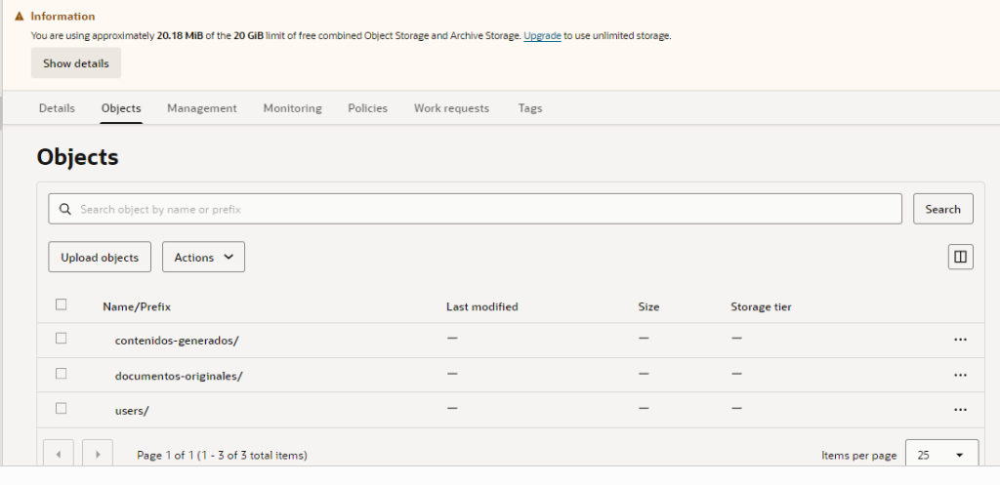
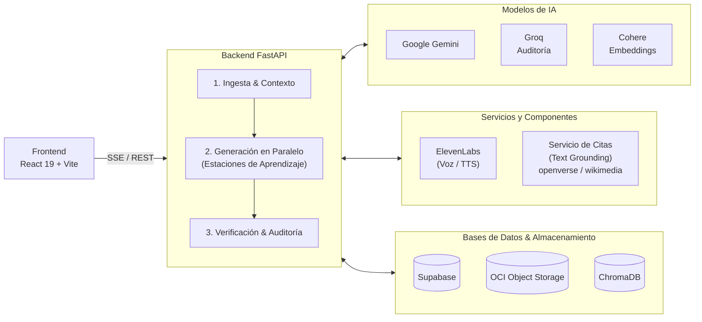

# 🧠 NuevaMente — Sistema Inteligente de Adaptación y Generación de Contenido Educativo

Desarrollado por el **Equipo 10** para **No-Country** (*Hackathon ONE G10 · Oracle Next Education & Alura Latam*).  
Convierte documentos técnicos en un recorrido de aprendizaje adaptativo de 5 estaciones según el perfil del estudiante, con citas verificadas y video narrado.

<p align="center">
  <a href="https://novamind.techgk.cl/"><strong>🌐 Demo en Vivo</strong></a> &nbsp;•&nbsp;
  <a href="https://www.youtube.com/watch?v=TU_VIDEO_AQUI"><strong>▶️ Video Demo (YouTube)</strong></a>
</p>

<p align="center">
  
  
  
  
  
  
  
  
  
  
  
  
  
  
</p>

<table>
  <tr>
    <td width="33%"></td>
    <td width="33%"></td>
    <td width="33%"></td>
  </tr>
  <tr>
    <td align="center"><sub>Biblioteca y «Explorar Demostración», sin iniciar sesión</sub></td>
    <td align="center"><sub>Los conceptos clave de un documento y su fuente verificada</sub></td>
    <td align="center"><sub>Persistencia y custodia en OCI Object Storage (Always Free)</sub></td>
  </tr>
</table>


## 🎯 Plataforma Educativa y Propuesta de Valor

**NuevaMente** convierte documentación técnica densa (manuales de arquitectura, reportes, guías y PDFs) en una experiencia formativa interactiva estructurada en **5 estaciones de aprendizaje**. 

A diferencia de un visor pasivo o un resumen genérico por IA, la experiencia se fundamenta en material didáctico progresivo diseñado para la comprensión y la práctica, sumando como valor agregado elementos diferenciadores clave:

### 🌟 Elementos Diferenciadores
- **Verificación Estricta de Citas (RAG Grounding):** Cada concepto clave y respuesta del cuestionario se ancla literalmente al documento original indicando la página real, erradicando alucinaciones.
- **Progresión Gamificada:** Sistema de aprendizaje interactivo con **325 XP acumulables** a lo largo de las estaciones y vitrina de **5 medallas de maestría**, con acceso a una experiencia cinematográfica interactiva mediante el botón **«Ver Sorpresa ✨»**.
- **Cabina de Dirección Audiovisual:** Teleprompter técnico sincronizado para el docente o relator, storyboard didáctico y microclases narradas renderizadas en el navegador con Remotion Player (sin procesamiento de video pesado en el servidor).
- **Aprendizaje Adaptativo Tridimensional:** Adaptación dinámica del contenido en 3 dimensiones para ajustarse con precisión al contexto de cada estudiante:

| Dimensión | Opciones Disponibles | Impacto en el Aprendizaje |
| :--- | :--- | :--- |
| **Perfil del Destinatario** | • **Principiante / Transición:** Conceptos base y analogías progresivas.<br/>• **Junior / Semi Senior:** Implementación práctica y buenas prácticas.<br/>• **Líder Técnico / Arquitecto:** Decisiones de diseño, SLA y resiliencia.<br/>• **Gestor / Ejecutivo:** Impacto en negocio, costos y mitigación de riesgos. | Modula el tono, el vocabulario técnico y la curva de dificultad según el rol. |
| **Nicho / Sector (11 áreas)** | Finanzas & Fintech, Medicina & Salud, E-commerce & Retail, Tecnología, Legal, Educación, Industria, entre otros. | Contextualiza las analogías, metáforas y casos prácticos a la realidad de la industria. |
| **Nivel de Detalle** | • **Didáctico:** Modelos mentales intuitivos y comandos esenciales.<br/>• **Técnico Profundo:** Sintaxis CLI con flags, topología de red y configuraciones avanzadas. | Adapta la exigencia práctica de los laboratorios y comandos en terminal. |

### Las 5 Estaciones de Aprendizaje

| Estación | Nombre | Contenido pedagógico |
| :---: | :--- | :--- |
| **1** | **Resumen** | Analogía central, conceptos clave con **citas textuales verificadas** en el documento original, resumen por secciones y mapa conceptual. |
| **2** | **Tarjetas Didácticas** | Preguntas y respuestas interactivas con pistas reflexivas (formato *flashcards* exportable a Anki). |
| **3** | **Guía Paso a Paso** | Tutorial práctico con metas de aprendizaje, instrucciones paso a paso y comprobaciones de éxito. |
| **4** | **Contenido Audiovisual** | Microclase narrada en video dinámico renderizado en el navegador con Remotion Player (sin procesamiento de video en el servidor). |
| **5** | **Cuestionario** | Examen de autoevaluación adaptado exactamente al temario enseñado en las estaciones previas. |

### Ingesta y Custodia en la Nube
- **Modo Invitado (sin cuenta):** Permite explorar de inmediato muestras pregeneradas de documentos reales (Apache Kafka, Don Quijote, ENISA, Snowflake, OCI Swap) con cero consumo de cuota de IA.
- **Con cuenta:** Permite subir documentos propios (PDF, Markdown, texto o imágenes escaneadas transcritas con IA).
- **Persistencia Cloud:** Documentos originales y paquetes JSON custodiados en un bucket privado de **OCI Object Storage** con exportación multiformato (Markdown, JSON estructurado, Anki CSV y PDF compilado con ReportLab).


## 🚀 1. Instalación y Ejecución

### Requisitos Previos
- **Python 3.12**
- **Node.js 18 o superior**

### 🔑 Variables de Entorno (.env)
Configura tus claves creando un archivo `.env` en la raíz (a partir de `.env.example`):

| Variable | ¿Obligatoria? | Propósito Técnico & Mecanismo de Respaldo |
| :--- | :---: | :--- |
| `GEMINI_API_KEY` | **Sí** | Generación pedagógica paralela, transcripción multimodal y TTS de respaldo. |
| `SUPABASE_URL` · `SUPABASE_PUBLISHABLE_KEY` | No | Autenticación y persistencia de progreso (el modo invitado no lo requiere). |
| `GROQ_API_KEY` | No | Auditoría ultrarrápida de fidelidad de afirmaciones contra el documento (>250 t/s). |
| `COHERE_API_KEY` | No | Adaptación de tono en cadena colaborativa y embeddings en modo clásico. |
| `ELEVENLABS_API_KEY` | No | Síntesis de voz para video (fallback a Gemini TTS o Web Speech del navegador). |
| `OCI_*` | No | Custodia en OCI Object Storage Always Free (fallback local a `data/outputs/`). |

> **Aviso de Seguridad:** Las claves secretas residen exclusivamente en el backend; el frontend solo expone variables públicas de configuración (`VITE_API_URL`, `VITE_SUPABASE_*`).

### En Windows (Automatizado en 1 clic)
1. Ejecuta `setup.bat` para crear automáticamente el entorno virtual `.venv` e instalar dependencias.
2. Abre el archivo `.env` generado y coloca tus claves de API (`GEMINI_API_KEY`).
3. Ejecuta `iniciar_local.bat` para levantar concurrentemente Backend (puerto 8000), Frontend (puerto 5173) y abrir el navegador.


### Puesta en Marcha Manual

#### 1. Backend (FastAPI)
```bash
# Crear entorno virtual
python -m venv .venv

# Activar entorno virtual
# En Windows:
.venv\Scripts\activate
# En Linux / macOS:
source .venv/bin/activate

# Instalar dependencias
pip install -r requirements.txt

# Configurar variables de entorno
cp .env.example .env

# Iniciar servidor Uvicorn
uvicorn app.main:app --app-dir backend --reload --port 8000
```
*API y documentación OpenAPI / Swagger activa en:* `http://localhost:8000/docs`

#### 2. Frontend (React 19 + TypeScript + Vite)
```bash
# Navegar a la carpeta frontend
cd frontend

# Instalar dependencias
npm install

# Configurar variables locales
cp .env.example .env.local

# Iniciar servidor de desarrollo
npm run dev
```

Abre tu navegador en **`http://localhost:5173/`** *(emplear `localhost` en lugar de `127.0.0.1` para habilitar el redireccionamiento de inicio de sesión con Supabase OAuth)*.


## 🏛️ 2. Arquitectura y Modos RAG

El frontend (React 19 + Vite) dibuja el recorrido y el reproductor de video; el backend (FastAPI) orquesta la ingesta, los modelos de lenguaje, la verificación estricta de citas y la persistencia en la nube.

<p align="center">
  
</p>



### Modos de Generación

| Modo | Estrategia | Descripción | Implementación |
| :--- | :--- | :--- | :--- |
| **`paralelo`** *(Predeterminado)* | **In-Context Grounding** | Gemini procesa el documento en paralelo y luego genera el cuestionario. Respuestas en tiempo real vía SSE con verificación determinista de citas. | `agentes/generacion_paralela.py` |
| **`vectorless`** | **Cadena Colaborativa** | Fallback cuando se agota cuota: Gemini genera, Cohere adapta el tono pedagógico y Groq audita la fidelidad. | `agentes/cadena_colaborativa.py` |
| **`clasico`** | **RAG Vectorial con Agentes** | Chunking, embeddings de Cohere, ChromaDB y ciclo reflexivo (*Investigador ➔ Productor ➔ Crítico*) con LangGraph. | `core/orchestrator.py` |

---

## 🔌 3. API REST Principal

| Método y Ruta | Descripción |
| :--- | :--- |
| `GET /health` | Chequeo de estado de los servicios |
| `GET /api/v1/config/opciones` | Lista de perfiles, sectores y niveles disponibles |
| `POST /api/v1/documentos/extraer` | Extracción de texto y transcripción OCR con IA |
| `POST /api/v1/adaptar/stream` | Generación del paquete educativo en tiempo real (SSE) |
| `POST /api/v1/narracion/generar` | Generación de audio TTS y activos para el video |
| `POST /api/v1/exportar/pdf` | Compilación y descarga del Dossier Pedagógico en PDF |
| `GET /api/v1/paquetes` | Consulta del historial de paquetes del usuario |

> 📖 La documentación interactiva Swagger se encuentra disponible en `http://127.0.0.1:8000/docs`.


## 📂 4. Estructura del Repositorio

```text
.
├── backend/
│   ├── app/
│   │   ├── main.py          # Endpoints REST, SSE y conmutación de modos
│   │   ├── auth.py          # Autenticación y control de acceso con Supabase
│   │   ├── agentes/         # Generación paralela, colaborativa y agentes LangGraph
│   │   ├── core/            # Contratos Pydantic, verificación de fuentes y configuración
│   │   ├── servicios/       # Integraciones con Gemini, Groq, Cohere, ElevenLabs
│   │   └── storage/         # Clientes de OCI Object Storage y almacenamiento local
│   └── tests/               # Pruebas automatizadas de backend con pytest
├── frontend/
│   ├── src/                 # Componentes React 19, navegación de estaciones y hooks
│   ├── public/ejemplos/     # Muestras pregeneradas para modo invitado
│   └── tests/               # Pruebas automatizadas de frontend
├── docs/                    # Diagramas técnicos y capturas de la aplicación
├── scripts/                 # Scripts de diagnóstico, limpieza y pruebas de carga
└── setup.bat · iniciar_local.bat · reestablecer_local.bat
```


## 🧪 5. Pruebas y Documentación

### Pruebas Automatizadas
Las pruebas unitarias y de integración son deterministas y utilizan mocks para los proveedores de IA:

```bash
# Pruebas de Backend (pytest)
cd backend && ../.venv/Scripts/python -m pytest -q

# Pruebas de Frontend (TypeScript y test runner)
cd frontend && npm test && npx tsc --noEmit -p .
```

### Documentación Adicional
- 📡 **Referencia de la API REST:** Consulta [backend/docs/API.md](backend/docs/API.md) para el catálogo de endpoints, schemas de solicitud/respuesta y streaming SSE.
- ⚙️ **Decisiones Técnicas y de Arquitectura:** Consulta [docs/DECISIONES.md](docs/DECISIONES.md) para conocer las alternativas descartadas, compromisos técnicos (*trade-offs*) y justificaciones de diseño.
- 📜 **Historial de Cambios y Auditorías:** Consulta [CHANGELOG.md](CHANGELOG.md) para el detalle de versiones y saneamiento de dependencias/certificados TLS.
- 🗺️ **Índice General del Proyecto:** Consulta [INDEX.md](INDEX.md) para un mapa exhaustivo de todos los documentos y especificaciones.


## 👥 6. Equipo 10, Créditos y Reconocimientos

### 🎖️ Hackathon ONE G10 (Oracle Next Education & Alura Latam · No-Country)

> **Muchas banderas y una misma meta.**  
> *Unidos para demostrar lo que el talento de nuestra región es capaz de construir. NovaMind nace de esta unión, y esto apenas comienza.* 💜

| Integrante | Rol / Responsabilidad Técnica | Redes / Perfiles |
| :--- | :--- | :---: |
| **Silvia Zamora** | Facilitación & Project Management | [LinkedIn](https://www.linkedin.com/in/silvia-zamora-valverde-3775a72ab) · [GitHub](https://github.com/silvet005-cpu) |
| **Gabriel Quineo** | Liderazgo Técnico Backend & Arquitectura RAG | [GitHub](https://github.com/gadeq) |
| **Carina Bosio** | Liderazgo Técnico Frontend & UI/UX | [LinkedIn](https://www.linkedin.com/in/carina-susana-bosio/) · [GitHub](https://github.com/CariBosio) |
| **Tomás Encina** | Backend & Cloud Integration | [LinkedIn](https://www.linkedin.com/in/tomas-encina-bugueno/) · [GitHub](https://github.com/toencina) |
| **Emanuel Lopez** | Backend & Cloud Integration | [LinkedIn](https://www.linkedin.com/in/emanuel-lopez-f/) · [GitHub](https://github.com/ema28pro) |
| **Pedro Ruiz** | Backend & Cloud Integration | [LinkedIn](https://www.linkedin.com/in/pedro-ruiz-307576398/) · [GitHub](https://github.com/pedroruizguerrero240-lab) |
| **Harumi Pereda Pascal** | Frontend, QA & Diseño de Producto | [LinkedIn](https://www.linkedin.com/in/harumi-pereda-pascal) · [GitHub](https://github.com/harumipereda) |
| **Alejandro Cárdenas** | Colaboración Técnica & Documentación | [LinkedIn](https://www.linkedin.com/in/alejandro-alfredo-cardenas/) · [GitHub](https://github.com/Al3x4nDr0s) |
| **Wilson Ignao** | Colaboración Técnica & Documentación | [LinkedIn](https://www.linkedin.com/in/wilsonignao/) · [GitHub](https://github.com/JuanWilson70) |

---

### 🌟 Agradecimientos Institucionales

> *"El equipo de **NuevaMente** extiende su más sincero agradecimiento a **Oracle Cloud Infrastructure (OCI)**, **Alura Latam** y **No-Country** por impulsar el talento tecnológico en Latinoamérica, brindando infraestructura en la nube de nivel mundial y un ecosistema de aprendizaje colaborativo de excelencia."*
