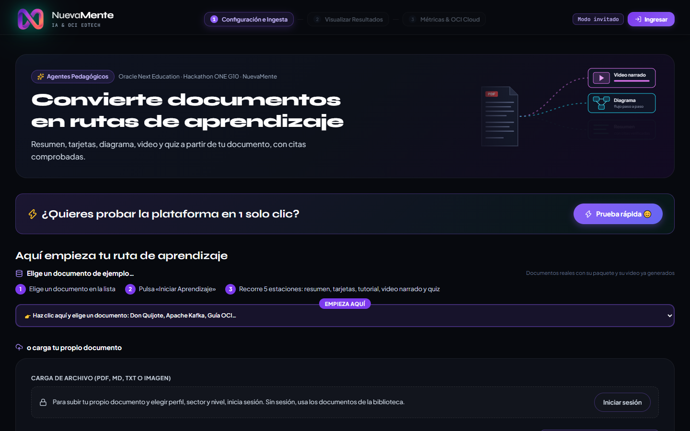
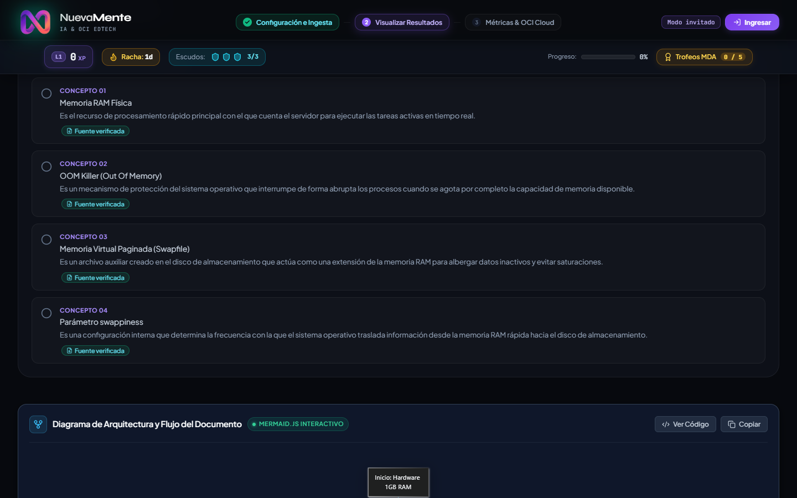
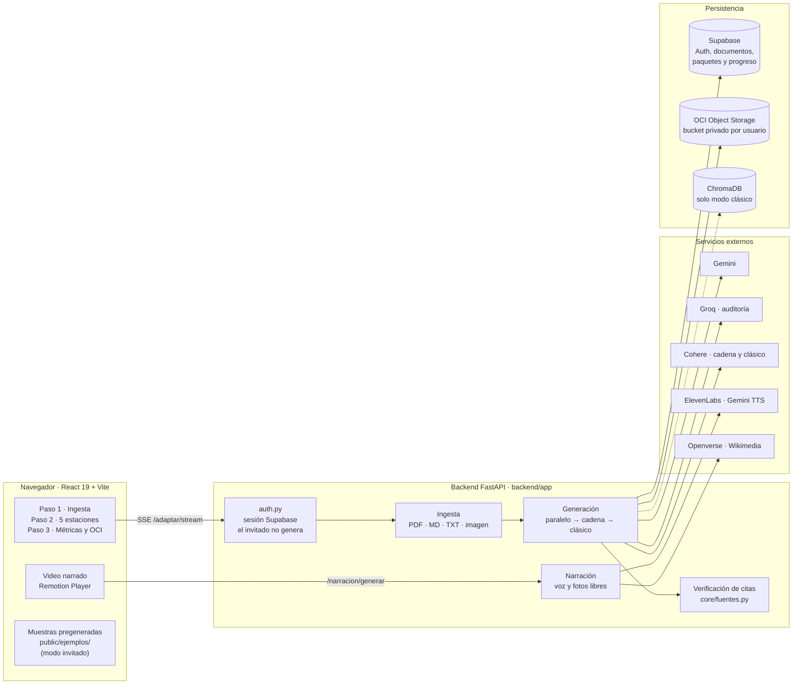
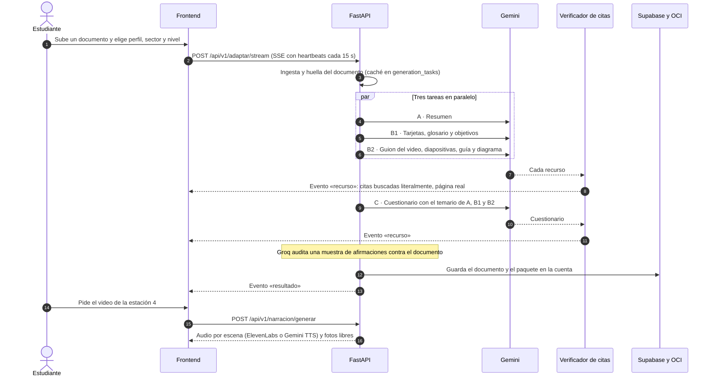
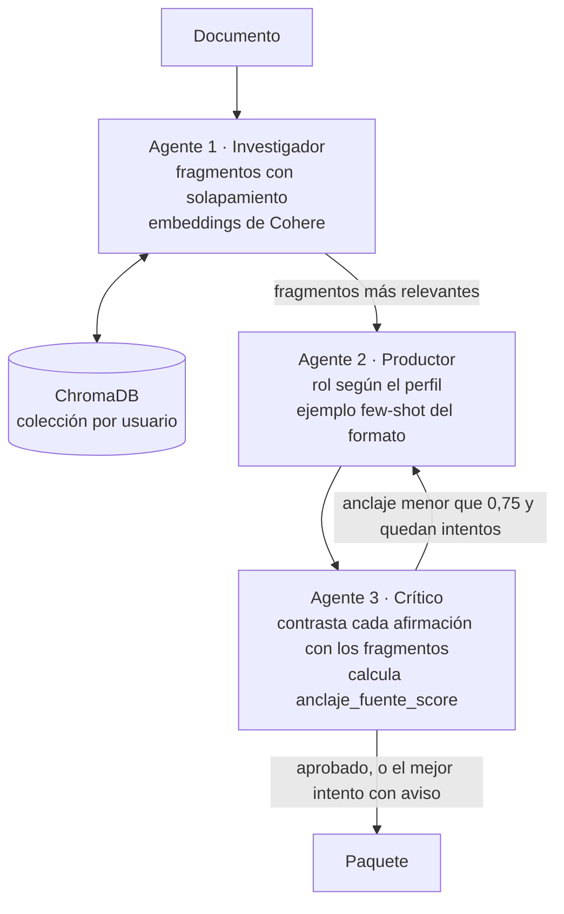

# 🧠 NuevaMente — Sistema Inteligente de Adaptación y Generación de Contenido Educativo

> **Desarrollado por el Equipo 10 (G10 - NuevaMente) para No-Country**  
> **Hackathon ONE G10 · Oracle Next Education & Alura · Proyecto 1**  
> Convierte un documento técnico en un recorrido de aprendizaje de 5 estaciones adaptado al perfil del estudiante, con citas verificadas contra el documento y un video narrado.

<p align="center">
  
  
  
  
  
  
  
  
  
  
  
</p>

<p align="center">
  
</p>

---

**🌐 Demo en vivo:** _próximamente_

<table>
  <tr>
    <td width="33%"></td>
    <td width="33%"></td>
      </tr>
  <tr>
    <td align="center"><sub>Biblioteca y prueba rápida, sin iniciar sesión</sub></td>
    <td align="center"><sub>Cada concepto con su cita verificada</sub></td>
    
  </tr>
</table>

---

## Cómo funciona

Las secciones siguientes detallan la arquitectura, los flujos y la puesta en marcha.

**Recorrido del estudiante**

1. **Configuración e ingesta.** Dos formas de entrar:
   - **Sin cuenta (invitado):** se exploran muestras ya generadas de cinco documentos reales (Don Quijote I y II, Apache Kafka, ENISA Threat Landscape y una guía de OCI), sin coste de IA. Kafka muestra cómo cambia el mismo documento según el perfil, el sector y el motor de generación. «Prueba rápida 😊» abre un ejemplo en un clic.
   - **Con cuenta:** se sube un documento propio (PDF, MD, TXT o imagen), se elige perfil, sector y nivel, y el paquete queda guardado en la cuenta.
2. **Visualizar Resultados: cinco estaciones.**

| Estación | Qué enseña |
|---|---|
| 1 · Resumen | Analogía central, conceptos con su cita verificada, resumen por secciones y diagrama Mermaid |
| 2 · Tarjetas didácticas | Pregunta y respuesta con pista |
| 3 · Guía paso a paso | «¿Cuál es la meta de leer "‹título›"?»: objetivos de aprendizaje y pasos con qué hacer y cómo comprobarlo; el comando en terminal solo si el documento es técnico |
| 4 · Contenido AudioVisual | Microclase narrada de hasta 60 s, dibujada en el navegador con Remotion Player (sin MP4 en el servidor) |
| 5 · Cuestionario | Examen final sobre lo que enseñaron las estaciones 1 a 4 |

3. **Métricas & OCI Cloud.** Auditoría de fidelidad y dónde quedó guardado el paquete.

**Base de datos (Supabase).** Las migraciones de `supabase/migrations/` se aplican en orden; la última, `202610160001_tarea_cuestionario.sql`, admite la tarea `C` en `generation_tasks`.

---

## 🏛️ 1. Arquitectura

El navegador dibuja el recorrido y el video; el backend ingiere, genera, verifica y guarda. Todos los servicios externos se usan en su capa gratuita.



**Los tres modos de generación (`modo_rag`)** y el relevo entre ellos (`backend/app/main.py`, `_generar_segun_modo`):

| Modo | Cuándo se usa | Qué hace | Código |
|---|---|---|---|
| `paralelo` | Siempre, desde la aplicación (`VITE_MODO_RAG`) | Gemini genera los recursos en paralelo y después el cuestionario; cada cita se busca en el documento, cada recurso llega por SSE apenas está listo y Groq audita una muestra (sección 2). Caché por huella en `generation_tasks`. | `agentes/generacion_paralela.py` |
| `vectorless` · cadena colaborativa | Si el paralelo no produce ningún recurso. Es el valor por defecto de la API si no se envía `modo_rag` | RAG sin vectores: el documento entra completo en el contexto. Gemini genera, Cohere adapta el tono al perfil y al sector, y Groq audita las afirmaciones (`anclaje_fuente_score`). | `agentes/cadena_colaborativa.py` |
| `clasico` · RAG vectorial | Si la cadena también falla, o pedido explícito | Fragmentos, embeddings de Cohere, búsqueda en ChromaDB y tres agentes en LangGraph (sección 3). | `core/orchestrator.py`, `agentes/agente{1,2,3}_*.py` |

Si un modo no da resultado, se pasa al siguiente y el paquete lo advierte: **paralelo → cadena colaborativa → clásico**. El modo paralelo solo conmuta si ninguna tarea produjo recursos; un recurso suelto que falla queda marcado como fallido y no se inventa. Dentro de la cadena, si Gemini falla, genera Groq; Cohere no genera, solo adapta el tono.

---

## 🔄 2. Flujo del modo paralelo (el que usa la aplicación)



Si un recurso falla, se marca como fallido y no se rellena. La página de cada cita sale del documento, nunca del modelo.

---

## 🧠 3. Flujo RAG y agentes (modo clásico)

Es el respaldo final y el que demuestra la ruta RAG con base vectorial. En la biblioteca, uno de los 5 escenarios de Apache Kafka está generado con este modo y lo indica.



El umbral (`MIN_ANCLAJE_FUENTE_SCORE`, 0,75) y los reintentos (`MAX_REDACCION_RETRIES`, 2) se configuran en `.env`. El grafo está en `backend/app/core/orchestrator.py` y los agentes en `backend/app/agentes/agente{1,2,3}_*.py`.

---

## 🔌 4. API

| Método y ruta | Para qué |
|---|---|
| `GET /health` | Estado del servicio |
| `GET /api/v1/config/opciones` | Perfiles, sectores, niveles y formatos |
| `POST /api/v1/documentos/extraer` | Texto de un archivo; imágenes y PDF escaneados se transcriben con Gemini |
| `POST /api/v1/adaptar` · `/adaptar/stream` | Genera el paquete (JSON completo, o por SSE recurso a recurso) |
| `POST /api/v1/narracion/generar` · `/narracion/ampliar` | Voz y fotos del video; ampliar una escena |
| `GET /api/v1/paquetes` · `/paquetes/{id}` | Historial privado de la cuenta |
| `GET /api/v1/documentos/ejemplos…` | Documentos de la biblioteca |

Todo lo que gasta cuota exige sesión. El invitado recibe 403: solo abre las muestras pregeneradas. La documentación interactiva está en `http://127.0.0.1:8000/docs`.

---

## 📂 5. Estructura del repositorio

```text
.
├── backend/
│   ├── app/
│   │   ├── main.py          # endpoints, relevo entre modos y SSE
│   │   ├── auth.py          # sesión de Supabase; el invitado no genera
│   │   ├── agentes/         # generacion_paralela.py (por defecto), cadena_colaborativa.py, agente1-3 (clásico)
│   │   ├── core/            # schemas.py (contratos), fuentes.py (citas), ingestion.py, config.py, orchestrator.py, prompts.py
│   │   ├── servicios/       # Gemini, voz, imágenes, narración, transcripción, registro de tareas
│   │   ├── storage/         # OCI, disco local y almacén de narraciones, separados por usuario
│   │   └── integration/     # adaptadores privados por usuario
│   └── tests/               # pytest; los modelos se simulan
├── frontend/
│   ├── src/                 # App.tsx, components/ (pasos y estaciones), services/, utils/, types/
│   ├── public/ejemplos/     # muestras pregeneradas: paquete, voz y fotos con su licencia
│   └── tests/               # node --test
├── contracts/fixtures/      # caso de referencia del modelo de tiempo, compartido por backend y frontend
├── supabase/                # migraciones y prueba de propiedad (RLS)
├── data/documents/          # documentos de la biblioteca
├── docs/                    # diagrama del flujo (SVG) y capturas de la app
├── scripts/                 # diagnóstico de OCI, prueba de estrés y restablecimiento local
├── tests/                   # pruebas del orquestador clásico
└── setup.bat · iniciar_local.bat · reestablecer_local.bat
```

---

## 🚀 6. Puesta en marcha local

**Requisitos:** Python 3.12 y Node.js 22 o superior.

**Claves** (en `.env`, a partir de `.env.example`; nunca en variables `VITE_*`):

| Variable | ¿Hace falta? | Para qué |
|---|---|---|
| `GEMINI_API_KEY` | Sí | Generación, transcripción de imágenes y voz de respaldo |
| `SUPABASE_URL` · `SUPABASE_PUBLISHABLE_KEY` | Sí (ya vienen en `.env.example`, son públicas) | Inicio de sesión y persistencia |
| `ELEVENLABS_API_KEY` | No | Voz del video; sin ella, Gemini TTS y, si tampoco, la voz del navegador |
| `GROQ_API_KEY` | No | Auditoría de fidelidad |
| `COHERE_API_KEY` | No | Modos cadena colaborativa y clásico |
| `OCI_*` | No | Bucket de OCI; sin ellas, el paquete se guarda en disco (`data/outputs/`) |

**En Windows:** `setup.bat` crea `.venv` e instala todo; `iniciar_local.bat` levanta el backend (puerto 8000) y el frontend (puerto 5173).

**A mano:**

```bash
python -m venv .venv
.venv/Scripts/python -m pip install -r requirements.txt     # Linux/macOS: .venv/bin/python
cp .env.example .env                                        # y completar las claves
.venv/Scripts/python -m uvicorn app.main:app --app-dir backend --port 8000

# en otra terminal
cd frontend
npm ci
cp .env.example .env.local
npm run dev
```

Abrir **http://localhost:5173**: con `localhost` y no `127.0.0.1`, porque es el origen autorizado para el inicio de sesión.

Las muestras de `frontend/public/ejemplos/` se regeneran con un script local que llama a un backend arrancado con `PERMITIR_GENERACION_INVITADO=true`. Ese permiso no debe ir nunca en un servidor público.

### Configurar el inicio de sesión (Supabase y Google)

- El backend verifica la sesión con HTTPX y la clave publicable: no necesita un secreto JWT ni una clave administrativa. El navegador usa `VITE_SUPABASE_URL` y `VITE_SUPABASE_PUBLISHABLE_KEY`; el backend, `SUPABASE_URL` y `SUPABASE_PUBLISHABLE_KEY`.
- El esquema `supabase/migrations/202610080001_auth_and_persistence.sql` **ya está aplicado en el proyecto NuevaMente**: no se vuelve a ejecutar sobre las tablas existentes. En un proyecto nuevo, se aplican las migraciones en orden y se configura Google. Para usar la CLI en el proyecto actual, hay que reconciliar el historial de migraciones antes de `db push`.
- **Google Cloud:** `http://localhost:5173` va en **Orígenes autorizados de JavaScript**, y la URI de redirección autorizada es la callback de Supabase: `https://pvgafxwsmatjebklmqlc.supabase.co/auth/v1/callback`.
- **Supabase Dashboard:** en Authentication → URL Configuration se permite `http://localhost:5173/auth/callback`. El Client ID y el Client Secret de Google se guardan en Authentication → Providers → Google; nunca en el frontend ni en variables `VITE_*`.
- El login con Google no necesita SMTP. El registro con correo y contraseña sí, si la confirmación de email está activada: para escribir a direcciones fuera del equipo hay que configurar un SMTP propio en Supabase Auth. El SMTP del backend (`SMTP_*`) es independiente y solo envía los dossiers en PDF.

---

## ⚙️ 7. Decisiones técnicas

1. **Procedencia honesta.** Nada se presenta como verificado si no lo está. Las citas se buscan literalmente en el documento y la página sale de ahí; un recurso que falla se muestra como fallido; si el texto lo transcribió la IA, se dice.
2. **Solo cuota gratuita.** El modo invitado no gasta cuota: el backend rechaza sus generaciones con 403 y las muestras son archivos estáticos. Las fotos son de bancos libres con licencias que permiten adaptarlas, y se muestran con autor y licencia.
3. **VM de OCI con 1 vCPU y 1 GB.** No hay MP4 ni FFmpeg en el servidor: el video son diapositivas narradas que dibuja el navegador. Las generaciones simultáneas se limitan con un semáforo (5 a la vez).
4. **Tres modos de RAG por los límites de cómputo y de cuota.** El orden de los modos responde a lo que la VM puede sostener:
   - **Paralelo y cadena colaborativa (RAG en contexto, sin vectores).** El documento completo, hasta 350.000 caracteres, viaja en la ventana de contexto del modelo, que lo lee entero sin una recuperación previa. El servidor solo orquesta llamadas HTTP asíncronas y verifica las citas con búsqueda de texto en Python: no genera embeddings, no carga un modelo y no mantiene un índice en memoria. Por eso son los modos principales.
   - **Clásico (RAG vectorial).** Fragmenta el documento (220 palabras por fragmento, con solapamiento) y pide los embeddings a Cohere por API, pero el índice vive en el propio proceso: ChromaDB `PersistentClient`, con SQLite en disco y el índice HNSW en RAM. En una VM de 1 GB, ese índice compite por memoria con FastAPI y las generaciones en curso. Por eso queda como último respaldo, solo cuando los otros dos modos fallan.
   - **Varios proveedores por la cuota gratuita.** Cada capa gratuita tiene límites por minuto y por día. Los errores 429 se clasifican en cuota por minuto o cuota diaria, los modelos agotados se recuerdan y se pasa al modelo de respaldo o al siguiente modo, en lugar de reintentar sobre un proveedor sin cuota.
5. **Cloudflare corta a los 100 s.** La generación va por SSE con heartbeats cada 15 s.
6. **Claves solo en el backend.** En el navegador solo hay valores públicos (`VITE_API_URL`, `VITE_SUPABASE_*`).
7. **Aislamiento por usuario.** El backend verifica el token con Supabase, consulta Postgres con el JWT del usuario (RLS) y guarda en OCI bajo `users/<UUID>/` en un bucket privado. ChromaDB también tiene una colección por usuario.
8. **CORS.** Se admiten `localhost` y `127.0.0.1` en cualquier puerto. En producción hay que agregar el dominio público a `allow_origins` en `backend/app/main.py`.
9. **Repositorio.** Este README es la única documentación publicada: en GitHub están el código, las pruebas, las migraciones y las muestras. La documentación por área, las bitácoras y el historial de cambios se conservan en local.

---

## 🧪 8. Pruebas automatizadas

Las pruebas son deterministas: Gemini, Groq, ElevenLabs y los bancos de imágenes se simulan, así que no gastan cuota.

```bash
cd backend && ../.venv/Scripts/python -m pytest -q
cd frontend && npm test && npx tsc --noEmit -p .
```

---

## 👥 9. Créditos

* **Equipo Backend**: API REST en FastAPI, ingesta multiformato, cliente de OCI Object Storage y despliegue en Oracle Cloud; motor multiagente en LangGraph, RAG vectorial con Cohere y ChromaDB, contratos con Pydantic v2 y pruebas automatizadas.
* **Equipo Frontend**: aplicación en React 19, TypeScript y Vite, cliente HTTP y SSE, las 5 estaciones y el panel de métricas.
* **Project Manager**: requerimientos funcionales, cronograma, actas de acuerdos y alineación con los objetivos del Hackathon ONE G10.
* **Equipo NuevaMente**: integración, contratos compartidos entre backend y frontend, scripts de ejecución local y entrega final.
