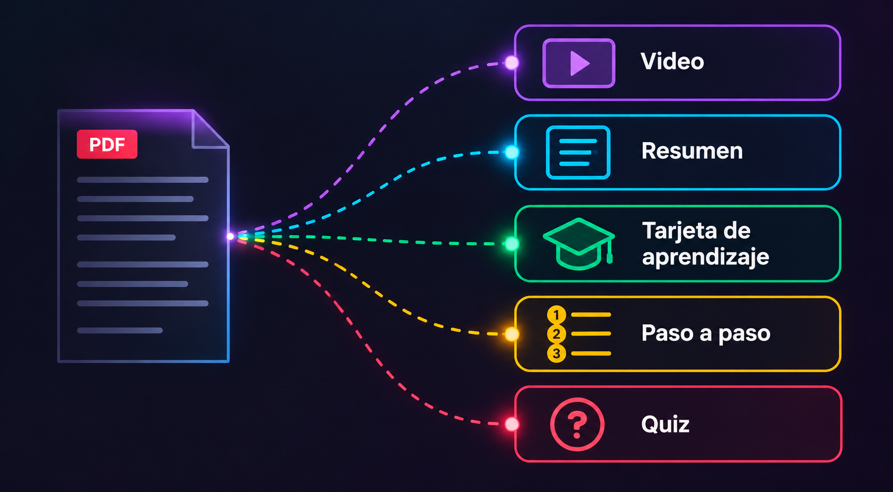
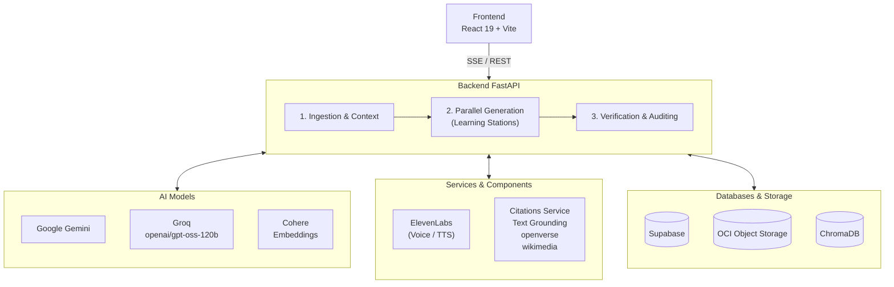

# 🧠 NovaMind — Intelligent Educational Content Adaptation & Generation System

Developed by **Team 10** for **No-Country** (*ONE G10 Hackathon · Oracle Next Education & Alura Latam*).  
Platform that converts complex technical documentation into an interactive 5-station learning journey adapted to the student's profile, with verified citations and narrated video.

<p align="center">
  <a href="https://novamind.techgk.cl/"><strong>🌐 Live Demo</strong></a> &nbsp;•&nbsp;
  <a href="https://youtu.be/TzeztU1YXLk"><strong>▶️ Demo Video (YouTube)</strong></a> &nbsp;•&nbsp;
  <a href="README.md"><strong>🇪🇸 Versión en Español</strong></a>
</p>

<p align="center">
  <br>
  
  <a href="https://opensource.org/licenses/MIT"></a>
  
</p>

<table>
  <tr>
    <td width="33%"></td>
    <td width="33%"></td>
    <td width="33%"></td>
  </tr>
  <tr>
    <td align="center"><sub>Library and «Explore Demo», without logging in</sub></td>
    <td align="center"><sub>Key document concepts and their verified sources</sub></td>
    <td align="center"><sub>Persistence and custody in OCI Object Storage</sub></td>
  </tr>
</table>

## 🎯 Introduction & Objectives

**NovaMind** transforms technical manuals, architecture reports, and dense documents (PDF, Markdown, plain text, or images) into structured, personalized learning experiences.

### Key Objectives
* **Zero Hallucinations (RAG Grounding):** Literal verification of citations against the source document, referencing the actual source page.
* **3D Adaptive Learning:** Dynamic personalization across 4 profiles (*Beginner*, *Junior*, *Architect*, *Executive*), 11 industry sectors (*Fintech, Healthcare, E-commerce, etc.*), and 2 depth levels (*Didactic* vs *Technical with CLI*).
* **Gamified Experience:** Learning path with **325 cumulative XP**, showcase of 5 mastery medals, and interactive experience via the **«See Surprise ✨»** button.
* **Lightweight Audiovisual Production:** Narrated micro-class rendered directly in the browser via Remotion Player with synchronized teleprompter (zero heavy server-side video rendering).



### The 5 Learning Stations
* **1. Summary:** Key concepts with verified citations from the original source, core analogy, and conceptual map.
* **2. Flashcards:** Interactive Q&A flashcards with reflective hints (exportable to Anki).
* **3. Step-by-Step Guide:** Procedural tutorial featuring learning goals, terminal commands, and success checkpoints.
* **4. Audiovisual Content:** Interactive narrated video with scene-by-scene audio and referenced visuals.
* **5. Capstone Quiz:** Formative assessment tailored specifically to the concepts taught throughout the journey.

## 🏛️ Architecture & Technologies

The system operates on a decoupled architecture where the frontend manages the interactive experience and the backend orchestrates document ingestion, AI models, and cloud persistence:



### Project Structure

```text
.
├── backend/
│   ├── app/
│   │   ├── main.py          # REST endpoints, SSE, and mode switching
│   │   ├── auth.py          # Authentication and access control with Supabase
│   │   ├── agentes/         # Parallel, collaborative generation, and LangGraph agents
│   │   ├── core/            # Pydantic schemas, source verification, and configuration
│   │   ├── servicios/       # Integrations with Gemini, Groq, Cohere, ElevenLabs
│   │   └── storage/         # OCI Object Storage clients and local storage
│   └── tests/               # Automated backend tests with pytest
├── frontend/
│   ├── src/                 # React 19 components, station navigation, and hooks
│   ├── public/ejemplos/     # Pre-generated samples for guest mode
│   └── tests/               # Automated frontend tests
├── docs/                    # Technical diagrams and application screenshots
├── scripts/                 # Diagnostic, cleanup, and stress-testing scripts
└── setup.bat · iniciar_local.bat · reestablecer_local.bat
```

### Core Stack
* **Frontend:** [React 19](https://react.dev/), [TypeScript 6.0](https://www.typescriptlang.org/), [Vite](https://vitejs.dev/), [Remotion Player](https://www.remotion.dev/), and CSS Modules.
* **Backend:** [FastAPI](https://fastapi.tiangolo.com/), [Uvicorn](https://www.uvicorn.org/), and [Pydantic v2](https://docs.pydantic.dev/).
* **AI Models:** Google Gemini 2.5 Flash, Groq (openai/gpt-oss-120b), Cohere, and ElevenLabs.
* **Persistence:** Oracle Cloud Infrastructure (OCI Object Storage Always Free) and Supabase (PostgreSQL with RLS).

## 🚀 Setup & Getting Started

### Prerequisites
* Python 3.12 and Node.js 18 or higher.
* A `.env` file in the root directory (created from `.env.example`). Only `GEMINI_API_KEY` is strictly required:

| Variable | Required? | Purpose |
| :--- | :---: | :--- |
| `GEMINI_API_KEY` | **Yes** | Content generation, multimodal transcription, and fallback TTS. |
| `SUPABASE_URL` · `SUPABASE_PUBLISHABLE_KEY` | No | Authentication and progress persistence (optional in guest mode). |
| `GROQ_API_KEY` · `COHERE_API_KEY` · `ELEVENLABS_API_KEY` | No | Fast auditing, semantic embeddings, and neural voice synthesis. |
| `OCI_*` | No | OCI Object Storage bucket (falls back locally to `data/outputs/` if absent). |

### ⚡ On Windows (1-Click)
1. Run `setup.bat` to automatically create the `.venv` virtual environment and install dependencies.
2. Add your `GEMINI_API_KEY` to `.env`.
3. Run `iniciar_local.bat` to launch Backend (port 8000), Frontend (port 5173), and open the browser.

### 🛠️ Manual Setup

```bash
# 0. Clone repository
git clone https://github.com/No-Country-simulation/G10-LATAM-equipo10NovaMind.git
cd G10-LATAM-equipo10NovaMind

# 1. Backend (FastAPI)
python -m venv .venv
# Activate: .venv\Scripts\activate (Windows) or source .venv/bin/activate (Linux/macOS)
pip install -r requirements.txt
cp .env.example .env
uvicorn app.main:app --app-dir backend --reload --port 8000

# 2. Frontend (React + Vite) — in another terminal
cd frontend
npm install
npm run dev
```

* Web Application: [http://localhost:5173/](http://localhost:5173/)
* Swagger Documentation: [http://localhost:8000/docs](http://localhost:8000/docs)

---

<p align="center">
  
</p>

## 🔗 Resources & Documentation Links

* 📡 **REST API Reference:** See [backend/docs/API.md](backend/docs/API.md) for the complete endpoint catalog, request/response schemas, and SSE streaming.
* ⚙️ **Technical Decisions & Trade-offs:** See [docs/DECISIONES.md](docs/DECISIONES.md) for discarded alternatives and 1 GB RAM memory architecture.
* 📜 **Version History & Security:** See [CHANGELOG.md](CHANGELOG.md) for release notes and TLS audits.
* 🗺️ **General Index:** See [INDEX.md](INDEX.md) for the complete documentation roadmap.
* 🧪 **Automated Testing:** Run `cd backend && pytest -q` and `cd frontend && npm test`.

## 👥 Team & Acknowledgments

### 🎖️ ONE G10 Hackathon (Oracle Next Education & Alura Latam · No-Country)

> **Many flags, one shared mission.**  
> *United to prove what Latin American tech talent can build. NovaMind was born from this collaboration, and this is just the beginning.* 💜

| Member | Technical Role / Responsibility | Profiles & Links |
| :--- | :--- | :---: |
| **Silvia Zamora** | Facilitation & Project Management | [LinkedIn](https://www.linkedin.com/in/silvia-zamora-valverde-3775a72ab) · [GitHub](https://github.com/silvet005-cpu) |
| **Gabriel Quineo** | Technical Lead Backend & RAG Architecture | [GitHub](https://github.com/gadeq) |
| **Carina Bosio** | Technical Lead Frontend & UI/UX | [LinkedIn](https://www.linkedin.com/in/carina-susana-bosio/) · [GitHub](https://github.com/CariBosio) |
| **Tomás Encina** | Backend & Cloud Integration | [LinkedIn](https://www.linkedin.com/in/tomas-encina-bugueno/) · [GitHub](https://github.com/toencina) |
| **Emanuel Lopez** | Backend & Cloud Integration | [LinkedIn](https://www.linkedin.com/in/emanuel-lopez-f/) · [GitHub](https://github.com/ema28pro) |
| **Pedro Ruiz** | Backend & Cloud Integration | [LinkedIn](https://www.linkedin.com/in/pedro-ruiz-307576398/) · [GitHub](https://github.com/pedroruizguerrero240-lab) |
| **Harumi Pereda Pascal** | Frontend, QA & Product Design | [LinkedIn](https://www.linkedin.com/in/harumi-pereda-pascal) · [GitHub](https://github.com/harumipereda) |
| **Alejandro Cárdenas** | Technical Collaboration & Documentation | [LinkedIn](https://www.linkedin.com/in/alejandro-alfredo-cardenas/) · [GitHub](https://github.com/Al3x4nDr0s) |
| **Wilson Ignao** | Technical Collaboration & Documentation | [LinkedIn](https://www.linkedin.com/in/wilsonignao/) · [GitHub](https://github.com/JuanWilson70) |

> *"Special thanks to **Oracle Cloud Infrastructure (OCI)**, **Alura Latam**, and **No-Country** for empowering technological talent in Latin America."*
