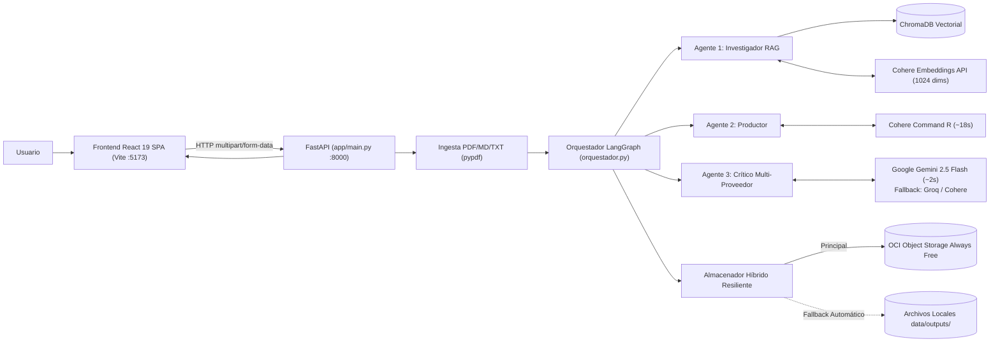
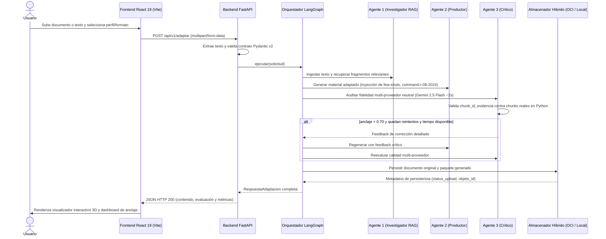
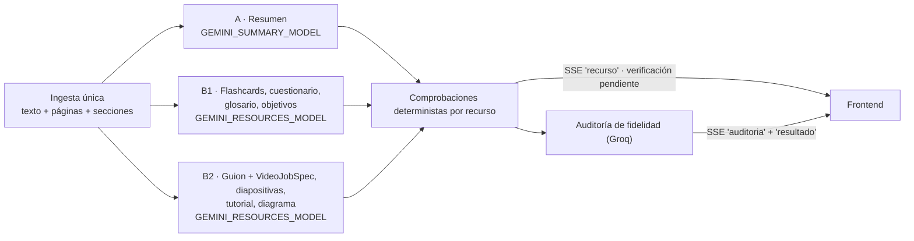

# Arquitectura del Sistema

## Vista General

El sistema **NuevaMente** opera bajo un modelo desacoplado cliente-servidor basado en microservicios, conectando una interfaz web moderna en **React 19 (Vite + TypeScript)** con una API REST en **FastAPI** y un motor de orquestación multi-agente en **LangGraph**:

## Componentes

### 1. Capa de Presentación (Frontend React 19)
- **`frontend/src/App.tsx`**: Orquestador del flujo de gamificación, HUD superior (XP, racha, escudos), modals de medallas (`BadgeModal`) y comunicación con la API.
- **`frontend/src/components/PlayerHUD/`**: Barra superior de estado gamificado en tiempo real (XP acumulado, racha diaria y 3 escudos cognitivos).
- **`frontend/src/components/Step1Ingestion/`**: Ingesta multi-formato con drag-and-drop (.pdf, .md, .txt, texto libre) y botón de 1-click **`⚡ Cargar Guía OCI Swap (Modo Demo)`** con preconfiguración pedagógica óptima.
- **`frontend/src/components/Step2KnowledgeQuest/`**: Orquestador del circuito pedagógico gamificado de 5 estaciones:
  - **Estación 1: Resumen Ninja (`Station1ResumenNinja`)**: Síntesis TL;DR con analogía central y métricas clave.
  - **Estación 2: Flashcard Quest (`Station2FlashcardQuest`)**: Tarjetas interactivas 3D con giros y pistas.
  - **Estación 3: Tutorial Quest (`Station3TutorialQuest`)**: Laboratorio CLI interactivo con sandbox de terminal Linux.
  - **Estación 4: Director Cut (`Station4DirectorCut`)**: Storyboard audiovisual y teleprompter estructurado por escenas con minutaje y consejos pedagógicos.
  - **Estación 5: The Final Trial (`Station5Quiz`)**: Cuestionario interactivo con retroalimentación RAG, citas textuales y penalización de escudos.
- **`frontend/src/components/Step3OCICloud/`**: Panel de auditoría de calidad RAG, Score de Anclaje a fuentes, metadatos de persistencia OCI Always Free y exportación de paquete en JSON.
- **`frontend/src/services/api.ts`**: Cliente HTTP nativo con Fetch API y `FormData` desacoplado, soporte de streaming SSE y fallback resiliente al banco de datos offline (`mockScenarios.ts`).

### 2. Capa de Servicios y API REST (Backend FastAPI)
- **`backend/app/main.py`**: Configuración de `FastAPI`, `CORSMiddleware`, endpoints canónicos (`/health`, `/api/v1/config/opciones`, `/api/v1/adaptar`, `/api/v1/adaptar/stream`, `/api/v1/paquetes`) y singleton del orquestador. Interoperabilidad transparente de parámetros (`documento_contenido` / `texto_directo`).
- **Desacople Asíncrono (`asyncio.to_thread`):** Ejecución de la inferencia fuera del hilo principal para garantizar que `/health` responda en < 10 ms (comprobado en prueba de estrés: 9.27 ms durante inferencia RAG pesada).
- **Semáforo de Concurrencia (`asyncio.Semaphore(1)`):** Encolamiento ordenado de peticiones concurrentes para proteger la memoria RAM (172 MB estables) en la instancia Always Free (1 GB) de OCI.
- **Canal Streaming SSE (`/api/v1/adaptar/stream`):** Emisión progresiva de eventos y heartbeats (`: ping`) cada 15s para neutralizar el timeout 524 de Cloudflare (100s).
- **`backend/app/ingestion.py`**: Extractor multi-formato para PDFs (limpieza de cabeceras y paginación vía `pypdf`), Markdown y TXT.
- **`backend/app/core/schemas.py`**: Contratos de datos estrictos en Pydantic v2 para los 5 formatos pedagógicos y el formato unificado `"Paquete Educativo Completo (5 Estaciones)"` con auto-reparación sintáctica de Quizzes.
- **`backend/app/core/config.py`**: Configuración centralizada multi-proveedor (`COHERE_*`, `GEMINI_*`, `GROQ_*`, `OCI_*`, `PROVEEDOR_CRITICO`).

### 3. Capa de Inteligencia Multi-Agente (LangGraph)
- **`backend/app/orquestador.py`**: Grafo de ejecución determinista con ciclo de feedback reflexivo:
  - **Nodo RAG (Agente 1)**: Indexación y recuperación contextual preservando embeddings Cohere `embed-multilingual-v3.0` (1024 dims).
  - **Nodo Redacción (Agente 2)**: Producción pedagógica con `command-r-08-2024` e inyección de few-shots por formato (~14-18s).
  - **Nodo Crítica (Agente 3 Multi-Proveedor)**: Fact-checking neutral desacoplado mediante patrón Fábrica (`ProveedorCritico`) con **Google Gemini 2.5 Flash** (~2s, structured outputs nativos) y fallback automático en cascada a **Groq (`llama-3.3-70b-versatile`)** y **Cohere (`command-r-08-2024`)**.
  - **Validación Determinista de Evidencias**: Verificación en Python de que los `chunk_id` citados por el Crítico existan en los fragmentos reales.
  - **Decisión / Bucle**: Aprobación directa si `anclaje >= 0.70`, o feedback correctivo con presupuesto de tiempo interno (`75.0s`).
  - **Nodo Persistir**: Persistencia híbrida mediante `almacenador_resiliente`.

### 4. Capa de Persistencia y Almacenamiento
- **ChromaDB**: Base vectorial local persistente (`./chroma_db` o `data/chroma/`) con métrica de similitud coseno (`cosine`).
- **OCI Object Storage Always Free (`backend/app/servicios/almacenamiento_oci.py`)**: Cliente oficial SDK (`oci.object_storage.UploadManager`) que persiste documentos originales en `documentos-originales/` y paquetes estructurados en `contenidos-generados/` dentro del bucket `novamind-contenidos-educativos` (`sa-santiago-1`).
- **Almacenamiento Local (`backend/app/servicios/almacenamiento_oci.py`)**: Respaldo automático transparente en `data/outputs/` si OCI está fuera de línea o sin credenciales configuradas.

## Flujo de Adaptación End-to-End

## Modo de generación paralela (`modo_rag=paralelo`)

Disponible en `POST /api/v1/adaptar` y `POST /api/v1/adaptar/stream`. Lo implementa `backend/app/agentes/generacion_paralela.py` sobre el cliente asíncrono `backend/app/servicios/servicio_gemini.py` (Interactions API, `store: false`). Los modelos se eligen por configuración (`GEMINI_SUMMARY_MODEL`, `GEMINI_RESOURCES_MODEL`); la clave `GEMINI_API_KEY` solo existe en el backend.

- **Concurrencia y Semáforos por Modelo:** las tres llamadas empiezan a la vez; B no depende de A. Un único `ClienteGemini` por proceso limita las llamadas simultáneas (`GEMINI_MAX_CONCURRENCIA`, por defecto 4), porque la cuota de Gemini es por proyecto. El modelo principal no tiene más límites; cuando se satura y las tareas caen al respaldo, un semáforo por modelo compartido por todo el proceso (`GEMINI_CONCURRENCIA_POR_MODELO`, por defecto 2, de 1 a 10) limita cuántas llamadas al respaldo van a la vez, sumando todas las generaciones en curso.
- **Comprobaciones antes de publicar:** validación Pydantic del JSON, ubicación de cada cita en el documento (`app/core/fuentes.py`, que ignora espacios, mayúsculas y marcas Markdown en línea; la página se deriva del offset y nunca se toma del modelo), eliminación de duplicados, preguntas con 4 alternativas distintas, cabecera Mermaid válida y el contrato de tiempos del guion (110–125 palabras, ≤ 60 s).
- **Aislamiento de errores y Resiliencia 429:** el fallo de una tarea o de un recurso solo afecta a ese recurso, que queda ausente con `estado_recursos[recurso].error_codigo`; nunca se rellena con contenido inventado.
  - **Clasificación 429:** `servicio_gemini.py` inspecciona los detalles de error `google.rpc.QuotaFailure` y `google.rpc.RetryInfo`. Si es `cuota_diaria`, el modelo se marca como agotado en memoria del proceso hasta la medianoche del Pacífico (hora de reseteo de cuota) y las llamadas subsecuentes hacen fail-fast directo al modelo de respaldo. Si es `cuota_minuto` con `retry_after_s <= 10.0` y presupuesto disponible, se espera y reintenta una sola vez; de lo contrario conmuta al respaldo.
  - **Mitigación de avalanchas (Jitter):** antes de llamar al modelo de respaldo se aplica una pausa aleatoria de 0 a 1,5 segundos.
  - **Proveniencia honesta:** las advertencias de los recursos indican explícitamente si se usó el modelo de respaldo y el motivo (`cuota diaria`, `cuota por minuto` o falta de respuesta).
  - Tras `PRESUPUESTO_GENERACION_S` (240 s) las tareas pendientes se cancelan (`presupuesto_agotado`). Si ninguna tarea produce recursos, la API conmuta a la cadena colaborativa y, si esta falla, al orquestador clásico.
- **Verificación:** `pendiente` al publicar; tras la auditoría, `auditada` (recursos cuyas afirmaciones se enviaron al auditor: resumen, flashcards, cuestionario, glosario, guion, tutorial) o `no_auditada`.
- **Narración:** no se genera aquí. La TTS es una acción bajo demanda y la microclase se reproduce en el navegador; el servidor no renderiza video.

Eventos SSE adicionales (el frontend actual los ignora; además se emiten eventos `progreso` equivalentes):

| `tipo` | Campos |
|---|---|
| `tarea` | `tarea` (`A`, `B1`, `B2`, `auditoria`), `estado` (`en_curso`, `completada`, `fallida`), `modelo`, `intentos`, `latencia_s`, `error_codigo` |
| `recurso` | `recurso`, `estado` (`EstadoRecurso`), `campos`: parche de `contenido_adaptado` listo para fusionar |
| `auditoria` | `auditoria_ejecutada`, `anclaje_fuente_score` (null si no se ejecutó), `verificacion` por recurso |

Medición real (guía de swap, 7,6 K caracteres, 12-oct-2026): B1 y B2 publicaron 8 recursos a los 7,5 s; A (`gemini-3.8-flash`) tardó 69,5 s; la auditoría, 2,6 s.

### Persistencia por recurso y reutilización (`generation_tasks`)

Migración: `supabase/migrations/202610120001_generation_tasks.sql` (ejecutar en el SQL Editor de Supabase después de `202610080001`). Añade `documents.content_hash` (un documento por usuario y contenido) y la tabla `generation_tasks`, con una fila por (usuario, huella de tarea, recurso), RLS `own_rows` y borrado en cascada con el documento.

- **Al empezar:** el backend crea (o reutiliza) la fila de `documents` con el JWT del usuario, así que RLS impone la propiedad también en la base de datos.
- **Huella de tarea:** `sha256(documento + perfil + nicho + nivel + tema + modelo + instrucciones + esquema + VERSION_PROCESADO)`. Si cambia el modelo o el prompt, nada se reutiliza.
- **Ciclo de cada fila:** `en_curso` antes de llamar al modelo → `completado` (con `result = {campos, afirmaciones, estado}`, el recurso ya validado, nunca la respuesta cruda) o `fallido` (`error_code` y un mensaje saneado) → `verification` final tras la auditoría.
- **Reutilización:** una generación idéntica publica los recursos completados sin llamar a Gemini (`estado_recursos[r].reutilizado = true`; evento `tarea` con estado `reutilizada`). Si una tarea quedó a medias, solo se regeneran sus recursos fallidos y se conservan los demás.
- **Solicitudes simultáneas idénticas** (doble clic, dos pestañas) del mismo usuario comparten la llamada a Gemini en vuelo.
- **Mejor esfuerzo:** si Supabase falla, la generación continúa y la respuesta lo advierte. Los invitados no se registran.

### Frontend: publicación incremental

- `frontend/src/services/api.ts` envía `modo_rag=paralelo` (configurable con `VITE_MODO_RAG`) y pliega los eventos `recurso` y `auditoria` con `frontend/src/utils/paqueteIncremental.ts` (puro, con tests en `frontend/tests/paqueteIncremental.test.ts`).
- El recorrido (Paso 2) se abre con el **primer recurso listo**; cada estación se habilita cuando su recurso termina. Si falla, la estación muestra «no disponible» con el motivo y **nunca contenido de relleno**. Se eliminaron los rellenos inventados: métricas genéricas en la Estación 1, diagrama Mermaid genérico, pregunta de quiz de reserva y «RAG Grounding 98%» en el pie de página.
- Cada estación muestra la verificación de su recurso (`pendiente` → `auditada` / `sin auditar`), las citas localizadas, la reutilización y los avisos. Las citas indican la página real o «no encontrada en el documento».
- Recursos de apoyo junto a su estación: objetivos y resumen ejecutivo por secciones (Estación 1), glosario (Estación 2) y diapositivas (Estación 4).
- `frontend/tests/e2e_sse_paralelo.manual.ts` prueba el flujo contra un backend real; no forma parte de `npm test` porque consume cuota de Gemini.
