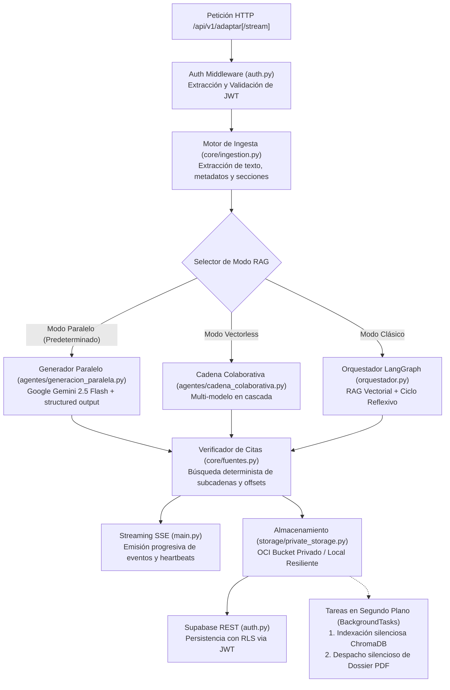

# Arquitectura Interna del Backend — FastAPI y Motor de Agentes

> Este documento detalla la arquitectura técnica interna del **Backend de NuevaMente** (`backend/app/`).  
> Para la vista general del ecosistema completo (incluyendo el Frontend React 19 y Remotion), consulta la [Arquitectura Global del Sistema](../../docs/ARCHITECTURE.md).


## 1. Diagrama de Flujo Interno del Backend




## 2. Estructura y Responsabilidad de Módulos

```
backend/app/
├── agentes/                    # Motores de inferencia y orquestación pedagógica
│   ├── generacion_paralela.py  # Generador principal: tareas A, B1, B2 y C en paralelo con Gemini
│   ├── cadena_colaborativa.py  # Fallback vectorless multi-proveedor
│   ├── agente1_investigador.py # Ingesta y búsqueda vectorial en ChromaDB (modo clásico)
│   ├── agente2_productor.py    # Redacción con Cohere Command R y few-shots
│   └── agente3_critico.py      # Fact-checking neutral y structured outputs
├── core/                       # Núcleo del dominio y utilidades transversales
│   ├── config.py               # Singleton de configuración y resolución de alias
│   ├── schemas.py              # Contratos Pydantic v2 de entrada y salida
│   ├── fuentes.py              # Verificación determinista de citas literales y cálculo de páginas
│   ├── ingestion.py            # Extracción multiformato (PDF vía pypdf, MD, TXT, OCR)
│   └── rag_pipeline.py         # Pipeline vectorial clásico de ChromaDB y Cohere embeddings
├── servicios/                  # Clientes de servicios externos de IA
│   ├── servicio_gemini.py      # Cliente asíncrono con control 429, jitter y semáforos
│   ├── servicio_narracion.py   # Control de cuota de voz, poda de guion y orquestador TTS
│   ├── servicio_voz.py         # Integración con ElevenLabs y Gemini Voice
│   ├── servicio_imagenes.py    # Búsqueda de imágenes en bancos libres con atribución
│   └── registro_tareas.py      # Caché de tareas intermedias en Supabase o memoria
├── storage/                    # Capa de almacenamiento y persistencia
│   ├── private_storage.py      # Guardado en OCI privado users/{user_id}/{run_id}/
│   ├── local_storage.py        # Fallback resiliente local en data/outputs/
│   └── almacen_narracion.py    # Almacenamiento de audios y guiones
├── integration/                # Integración con servicios de notificación
│   └── private_pipeline.py     # Generación de dossier PDF y despacho de correo
├── auth.py                     # Dependencias FastAPI para Supabase Auth, JWT y RLS
├── orquestador.py              # Definición del grafo de estados LangGraph (modo clásico)
└── main.py                     # Instancia FastAPI, CORS, semáforos y rutas HTTP
```


## 3. Modos de Generación Pedagógica

### Modo 1: Paralelo (`modo_rag="paralelo"`)
Es el motor predeterminado y de mayor rendimiento:
- **Tecnología:** Google Gemini 2.5 Flash mediante API asíncrona (`servicio_gemini.py`).
- **RAG en Contexto (*In-Context Grounding*):** Se suministra el documento fuente completo (hasta 350.000 caracteres) en la ventana de contexto.
- **Paralelismo:**
  - **Tarea A:** Resumen holístico, analogía central cotidiana y desglose por secciones.
  - **Tarea B1:** Flashcards 3D, glosario técnico y objetivos de aprendizaje.
  - **Tarea B2:** Guía práctica paso a paso, guion audiovisual y diapositivas.
  - **Tarea C:** Cuestionario evaluativo. Se ejecuta una vez consolidados A, B1 y B2 para garantizar que el examen evalúe estrictamente el temario enseñado.
- **Semáforos por Modelo:** Un semáforo global `GEMINI_MAX_CONCURRENCIA = 4` y un semáforo de respaldo `GEMINI_CONCURRENCIA_POR_MODELO = 2` protegen las cuotas de Google AI Studio.

### Modo 2: Cadena Colaborativa (`modo_rag="vectorless"`)
- Orquesta modelos alternativos en secuencia (Groq `llama-3.3-70b-versatile` y Cohere `command-r-08-2024`) cuando el proveedor principal agota cuota o sufre latencias elevadas.

### Modo 3: Clásico (`modo_rag="clasico"`)
- Grafo de ejecución determinista en **LangGraph** (`orquestador.py`):
  1. **Investigador RAG:** Fragmentación semántica en chunks de 700 caracteres, vectorización con Cohere `embed-multilingual-v3.0` (1024 dims) y almacenamiento en ChromaDB local.
  2. **Productor:** Generación con Cohere Command R e inyección de *few-shots* específicos.
  3. **Crítico:** Auditoría de afirmaciones y verificación de evidencia.
  4. **Ciclo Reflexivo:** Bucle de reintento si el score de anclaje es `< 0.70` dentro de un presupuesto temporal de 75 segundos.


## 4. Verificación Determinista de Citas (`core/fuentes.py`)

A diferencia de sistemas que confían en el número de página que estima el LLM:
1. El backend recibe las citas generadas por el modelo.
2. Normaliza el texto fuente y la cita (eliminando espacios redundantes y marcas de bloque como ```` ```bash ````).
3. Localiza la posición de carácter exacta (*offset*) en el documento crudo.
4. Calcula matemáticamente el número de página real basándose en los límites de página detectados durante la ingesta.
5. Extrae el contexto circundante para alimentarlo al **Visor de Fuentes** del frontend.


## 5. Tareas en Segundo Plano (*Background Tasks*)

Tras responder al cliente en `/api/v1/adaptar`, FastAPI despacha dos tareas asíncronas para usuarios registrados:
1. **Indexación Silenciosa:** Ingesta el documento en la base vectorial ChromaDB para enriquecer el historial sin retrasar la respuesta inicial.
2. **Despacho Silencioso de Dossier:** Genera un PDF estructurado de alta fidelidad y lo archiva en OCI Object Storage o lo despacha por correo electrónico si se proporcionó una dirección.

---

## 🔗 Navegación
* 🧭 [**Índice General del Proyecto (#back)**](../../INDEX.md#back)
* 📚 [**Directorio de Guías del Backend**](README.md)
* 🚀 [**Portada del Backend**](../README.md)
