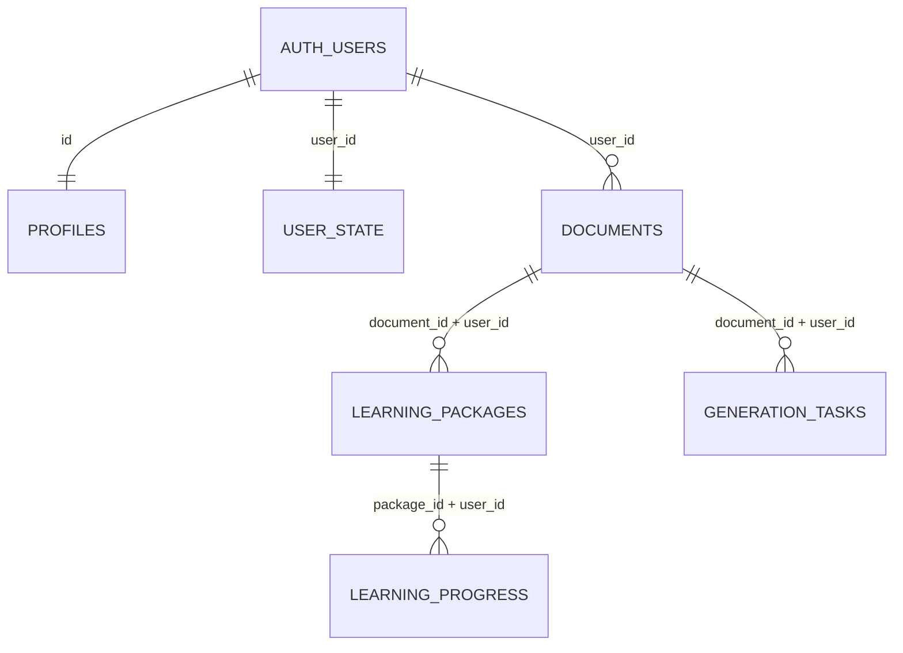

# Datos, Persistencia y Almacenamiento

## Panorama de Persistencia

El sistema **NuevaMente** utiliza una arquitectura de almacenamiento híbrida y desacoplada según el tipo y ciclo de vida de los datos:

| Almacén | Qué guarda | Implementación / Ubicación |
|---|---|---|
| **Supabase (PostgreSQL + Auth)** | Usuarios, perfiles, documentos originales, paquetes JSON completos, progreso pedagógico, estado de gamificación y caché de tareas | `supabase/migrations/` |
| **OCI Object Storage** (Bucket Privado) | Respaldo en la nube de texto original, paquete JSON y audios WAV/MP3 de narraciones | `backend/app/storage/private_storage.py` |
| **Disco Local** (`data/outputs/`) | Réplica idéntica a OCI ante ausencia de credenciales o fallos de red (Fallback Resiliente) | `backend/app/storage/local_storage.py` |
| **ChromaDB Vectorial** (`data/chroma/`) | Base de datos vectorial persistente con embeddings Cohere para el modo RAG clásico | `backend/app/core/rag_pipeline.py` |
| **Memoria del Proceso** | Caché temporal volátil de tareas para usuarios invitados (`RegistroMemoria`) | `backend/app/servicios/registro_tareas.py` |


## 1. Supabase (PostgreSQL y RLS)

### Migraciones Oficiales (`supabase/migrations/`)
Las migraciones se ejecutan secuencialmente en el SQL Editor de Supabase como rol administrativo `postgres`. Cada una está encapsulada en una transacción atómica:

1. **`202610080001_auth_and_persistence.sql`**:
   - Define las tablas núcleo: `profiles`, `documents`, `learning_packages`, `learning_progress` y `user_state`.
   - Crea el trigger `private.handle_new_user` que inicializa automáticamente el perfil y el estado del jugador cuando un nuevo usuario se registra en Supabase Auth.
   - Configura el bucket de storage privado `documents`.
2. **`202610120001_generation_tasks.sql`**:
   - Añade `documents.content_hash` para deduplicación (un documento por usuario y hash SHA-256).
   - Crea la tabla `generation_tasks` para almacenar el resultado y estado de cada tarea individual (`A`, `B1`, `B2`, `C`).
3. **`202610160001_tarea_cuestionario.sql`**:
   - Actualiza la restricción `generation_tasks_task_check` para admitir la tarea `C` (Cuestionario final generado sobre el temario consolidado).


### Diagrama Entidad-Relación



### Descripción de Tablas

| Tabla | Contenido y Función | Quién Escribe |
|---|---|---|
| **`profiles`** | Nombre visible, correo y avatar del usuario. | Trigger `handle_new_user` |
| **`documents`** | Título, archivo, texto fuente completo y `content_hash` (SHA-256). | Backend (`app/auth.py`) |
| **`learning_packages`** | Paquete educativo adaptado (`payload` JSON completo) y parámetros pedagógicos. | Backend y Frontend |
| **`learning_progress`** | Estación activa, estaciones completadas, respuestas al quiz y escudos gastados. | Frontend |
| **`user_state`** | Puntos de experiencia (XP), racha diaria, insignias y preferencias de accesibilidad. | Frontend |
| **`generation_tasks`** | Caché por recurso (usuario, huella SHA-256, tarea): estado, modelo, reintentos y resultado. | Backend (`registro_tareas.py`) |


### Políticas de Seguridad (Row Level Security - RLS)

- **RLS Activo en el 100% de las tablas:** Todas las tablas cuentan con políticas `own_rows` que obligan a que `user_id = auth.uid()` (o `id = auth.uid()` en `profiles`).
- **El backend no utiliza la clave `service_role`:** Todas las operaciones de base de datos desde la API (`private_query`, `private_insert`, `private_upsert`) se efectúan utilizando el token JWT del usuario final, garantizando que el motor de PostgreSQL haga cumplir las políticas de aislamiento multi-inquilino.
- Los usuarios anónimos (`anon`) no poseen permisos directos de lectura ni escritura sobre ninguna tabla.


## 2. Oracle Cloud (OCI) Object Storage

El almacenamiento en la nube se gestiona a través de `backend/app/storage/private_storage.py`:

```
users/{user_id}/{run_id}/original.txt
users/{user_id}/{run_id}/package.json
users/{user_id}/narraciones/...        (Audios WAV/MP3 por escena y guion)
```

- **Bucket Privado Obligatorio:** Requiere la configuración `NoPublicAccess` en OCI; si el bucket es público, el backend aborta la subida por seguridad.
- **Modo Resiliente:** Si no se suministra la clave de OCI (`OCI_KEY_FILE`), el sistema escribe los archivos de forma idéntica en `data/outputs/users/{user_id}/...` y reporta `status_upload="completado"` con `bucket="local-mock-storage"`.
- **Usuarios Invitados:** Para usuarios sin sesión no se persiste nada en OCI (`status_upload="omitido"`). Sus tareas temporales se almacenan en la memoria RAM del proceso y se descartan al reiniciar.


## 3. ChromaDB Vectorial

Utilizado principalmente por el **Modo Clásico (RAG Vectorial)** y por la indexación silenciosa en segundo plano:
- **Directorio de Persistencia:** `data/chroma/`.
- **Embeddings:** Cohere `embed-multilingual-v3.0` (1024 dimensiones) con métrica de similitud coseno (`cosine`).
- **Aislamiento:** Filtrado de colecciones por `user_id` o `document_id`.

---

## 🔗 Navegación
* 🧭 [**Índice General del Proyecto (#back)**](../../INDEX.md#back)
* 📚 [**Directorio de Guías del Backend**](README.md)
* 🚀 [**Portada del Backend**](../README.md)
