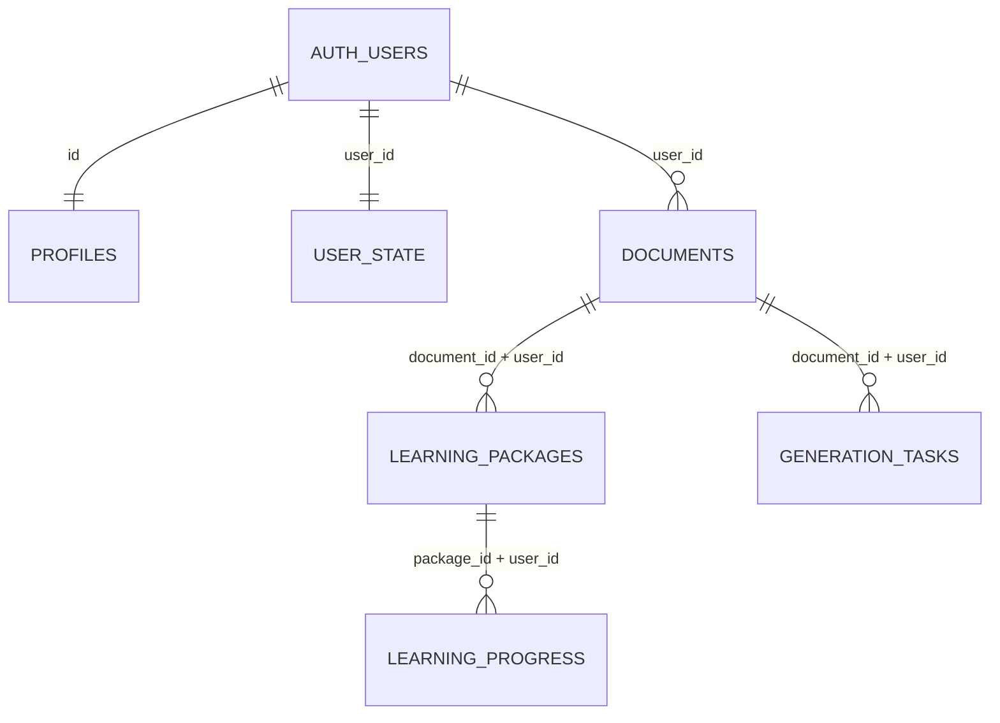

# Datos y persistencia

## Panorama

| Almacén | Qué guarda | Dónde está definido |
|---|---|---|
| **Supabase (PostgreSQL + Auth)** | Usuarios, documentos, paquetes, progreso, estado del jugador y caché por recurso | `supabase/migrations/` |
| **OCI Object Storage** (bucket privado) | Texto original y paquete JSON de cada generación; audio y guion de la narración | `app/storage/private_storage.py`, `app/storage/almacen_narracion.py`, `app/storage/oci_client.py` |
| **Disco del servidor** (`data/outputs/`) | Lo mismo que OCI cuando no hay credenciales de OCI | `app/storage/local_storage.py`, `app/storage/almacen_narracion.py` |
| **Memoria del proceso** | Caché de invitados (no se guarda en ningún sitio) | `RegistroMemoria` en `app/servicios/registro_tareas.py` |

ChromaDB solo lo usa el modo RAG antiguo (`orquestador.py`, `core/rag_pipeline.py`). El modo por defecto (`paralelo`) no tiene índice vectorial: el anclaje se comprueba localizando cada cita en el documento (`core/fuentes.py`).

## Supabase

### Migraciones

Se aplican en orden desde el SQL Editor, como `postgres`. Cada una va dentro de una transacción: si falla, no deja nada a medias.

1. `202610080001_auth_and_persistence.sql`: tablas `profiles`, `documents`, `learning_packages`, `learning_progress` y `user_state`; trigger que crea el perfil y el estado al registrarse un usuario; bucket de Storage privado `documents` (opcional: hoy los originales van a OCI).
2. `202610120001_generation_tasks.sql`: columna `documents.content_hash` (un documento por usuario y contenido) y tabla `generation_tasks`.

### Tablas



| Tabla | Contenido | Quién escribe |
|---|---|---|
| `profiles` | Nombre visible y avatar | Trigger `private.handle_new_user` |
| `documents` | Título, archivo, texto fuente y `content_hash` (sha256 de título + contenido) | Backend (`auth.py`) |
| `learning_packages` | Paquete educativo completo (`payload` JSON) y parámetros | Backend y front (`services/persistence.ts`) |
| `learning_progress` | Paso, estación activa, estaciones completadas, respuestas del quiz y escudos | Front |
| `user_state` | XP, racha, logros y preferencias (lo envía el cliente: no es un ranking fiable) | Front |
| `generation_tasks` | Una fila por (usuario, huella, recurso): estado, modelo, intentos, latencia, error saneado y resultado ya validado | Backend (`servicios/registro_tareas.py`) |

`generation_tasks.content_hash` es la huella de la tarea: sha256 de documento, perfil, nicho, nivel, tema, modelo, instrucciones y esquema. Si cambia el prompt o el modelo, la huella cambia y no se reutiliza nada viejo. El registro es de mejor esfuerzo: si Supabase falla, la generación sigue y la próxima vez se repite.

### Seguridad

- **RLS activo en las 6 tablas**, con una política `own_rows`: cada usuario solo ve y escribe sus filas (`user_id = auth.uid()`; en `profiles`, `id = auth.uid()`).
- `anon` no tiene permisos sobre ninguna tabla; `authenticated` tiene `select/insert/update/delete`, siempre filtrado por RLS.
- **El backend no usa la `service_role` key.** Llama a la API REST de Supabase con la *publishable key* y el JWT del usuario (`auth.py`: `private_query`, `private_insert`, `private_upsert`), así que cada consulta pasa por RLS.
- Las funciones de `private` (`set_updated_at`, `handle_new_user`) no son ejecutables por `anon` ni `authenticated`.

## OCI Object Storage y disco local

`storage_for(user_id)` (`storage/private_storage.py`) guarda cada generación de un usuario con cuenta:

```
users/{user_id}/{run_id}/original.txt
users/{user_id}/{run_id}/package.json
users/{user_id}/narraciones/...        (audio WAV por escena y guion del video)
```

- **Con `OCI_KEY_FILE`:** sube al bucket de `OCI_BUCKET_NAME` y **exige que sea privado** (`NoPublicAccess`); si es público, no sube nada. Devuelve `status_upload="completado"` con el bucket y el objeto.
- **Sin `OCI_KEY_FILE`:** escribe en `data/outputs/users/...` del servidor y devuelve `status_upload="completado"` con `bucket="local-mock-storage"`. La Estación 3 lo muestra como «Guardado en el servidor, no en OCI».
- **Invitados:** no se guarda nada (`status_upload="omitido"`). Su caché vive en memoria (`MAX_FILAS_CACHE_INVITADOS`, 200 filas por defecto) y se pierde al reiniciar.
- **Error al subir:** `status_upload="error"` y una advertencia en la respuesta; el paquete se entrega igual.

Las rutas antiguas `documentos-originales/` y `contenidos-generados/` (`storage/oci_client.py`) solo las usan el modo RAG antiguo y el archivado del PDF del correo.

## Contratos

Los modelos Pydantic de `backend/app/core/schemas.py` son la fuente de verdad de los JSON; su espejo en el front es `frontend/src/types/types.ts`.
