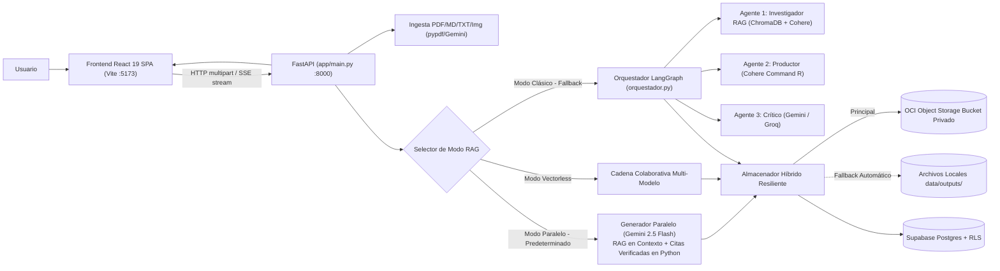
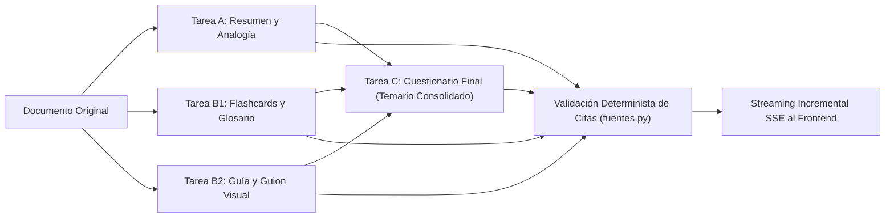

# Arquitectura Global del Sistema — NuevaMente

## Vista General

El sistema **NuevaMente** opera bajo un modelo desacoplado cliente-servidor basado en microservicios, conectando una interfaz web moderna en **React 19 (Vite + TypeScript)** con una API REST en **FastAPI** y un motor de orquestación pedagógica multi-modelo y multi-agente:

---

## Componentes del Ecosistema

### 1. Capa de Presentación (Frontend React 19 SPA)
- **Tecnologías:** React 19, TypeScript 5+, Vite, Tailwind CSS y Lucide Icons.
- **`App.tsx`**: Orquestador del flujo general, HUD superior (XP acumulado, racha diaria, escudos cognitivos), modales de logros (`BadgeModal`) y comunicación con la API.
- **`PlayerHUD/`**: Barra superior de estado gamificado en tiempo real con estadísticas de progreso pedagógico.
- **`Step1Ingestion/`**:
  - Zona nativa e interactiva de *Drag & Drop* para subida de archivos (.pdf, .md, .txt e imágenes/OCR).
  - Selector de biblioteca con muestras pregeneradas libres de costo de IA (Don Quijote I y II, Apache Kafka, ENISA, Snowflake y Guía de Swap de OCI).
  - Configuración pedagógica: selector de Perfil (Personalizado, Desarrollador, Líder Técnico, Gestor), Nicho Sectorial (11 sectores canónicos) y Nivel de Detalle (Didáctico, Intermedio, Profundo).
- **`Step2KnowledgeQuest/`**: Circuito pedagógico gamificado de 5 estaciones:
  - **Estación 1 · Resumen (`Station1ResumenNinja`)**: Síntesis con analogía central cotidiana, conceptos verificados con citas al documento, resumen estructurado por secciones y diagrama interactivo en Mermaid.
  - **Estación 2 · Tarjetas didácticas (`Station2FlashcardQuest`)**: Flashcards interactivas 3D con pregunta, respuesta y pista; aprobación por concepto dominado y glosario de términos técnicos.
  - **Estación 3 · Guía paso a paso (`Station3TutorialQuest`)**: Metas pedagógicas del documento (`objetivos_aprendizaje`), pasos de acción con terminal interactivo solo para comandos ejecutables reales (`utils/pasoGuia.ts`) y criterios de validación («¿Cómo sé que lo logré?»).
  - **Estación 4 · Contenido AudioVisual (`Station4DirectorCut`)**: Teleprompter, desglose de escenas y microclase narrada reproducida directamente en el navegador mediante **Remotion Player** (`video/`), con subtítulos dinámicos activables/desactivables (CC) y pantalla completa. Sin renderizado de MP4 en el servidor.
  - **Estación 5 · Cuestionario (`Station5Quiz`)**: Examen final generado estrictamente sobre el temario enseñado en las estaciones 1 a 4, con justificaciones y citas a la fuente.
- **`Step3OCICloud/`**: Panel de auditoría de calidad RAG, métricas de fidelidad documental, metadatos de persistencia en Oracle Cloud Always Free y exportación de paquetes JSON.
- **`services/api.ts`**: Cliente HTTP nativo con soporte de streaming Server-Sent Events (SSE), reconexión y fallback a escenarios offline.

---

### 2. Capa de Servicios y API REST (Backend FastAPI)
Para el detalle técnico exclusivo de la API, consulta [backend/docs/ARCHITECTURE.md](../backend/docs/ARCHITECTURE.md) y [backend/docs/API.md](../backend/docs/API.md).
- **FastAPI Asíncrono:** Endpoints desacoplados con `asyncio.to_thread` para respuesta inmediata en `/health` (< 10 ms).
- **Semáforos de Concurrencia:** Protección contra *Out-of-Memory* (OOM) en VM de 1 GB RAM de OCI con semáforo global (`Semaphore(5)`), de invitados (`Semaphore(2)`) y de modelos IA.
- **Streaming SSE Incremental:** Canal `/api/v1/adaptar/stream` con heartbeats cada 15 segundos para evitar el timeout 524 de Cloudflare.

---

### 3. Modos de Adaptación Pedagógica

1. **Modo Paralelo (Predeterminado — In-Context Grounding):** Inyecta el texto completo en la ventana de contexto de Google Gemini 2.5 Flash y ejecuta las subtareas en paralelo, consolidando el temario para el cuestionario final.
2. **Modo Cadena Colaborativa (`vectorless`):** Fallback multi-proveedor que encadena modelos alternativos (Groq, Cohere) si el principal agota cuota.
3. **Modo Clásico (RAG Vectorial con LangGraph):** Fragmentación en chunks, embeddings Cohere (`embed-multilingual-v3.0`), ChromaDB local y ciclo reflexivo de tres agentes (*Investigador ➔ Productor ➔ Crítico*).

---

### 4. Capa de Persistencia y Almacenamiento

- **Supabase (PostgreSQL + RLS):** Gestión de usuarios, perfiles, documentos y paquetes con políticas estrictas de aislamiento multi-inquilino (`user_id = auth.uid()`).
- **OCI Object Storage Always Free:** Bucket privado `nuevamente-contenidos-educativos` (`sa-santiago-1`) con particionamiento `users/{user_id}/{run_id}/`.
- **Almacenamiento Local Resiliente (`data/outputs/`):** Fallback automático cuando no hay credenciales en la nube.
- **ChromaDB Vectorial (`data/chroma/`):** Base vectorial local para el modo RAG clásico.
